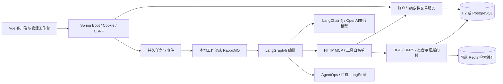
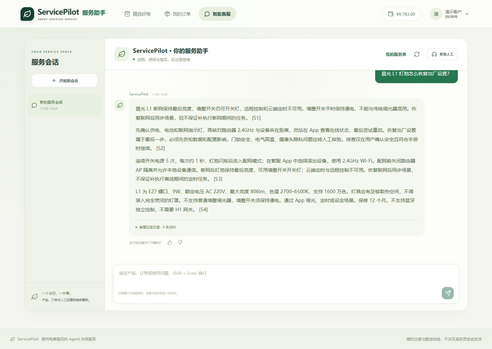
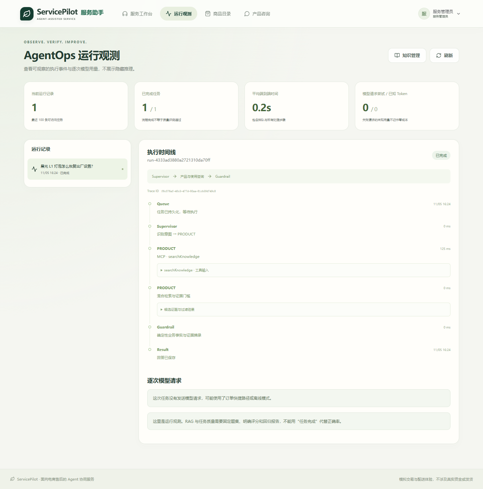
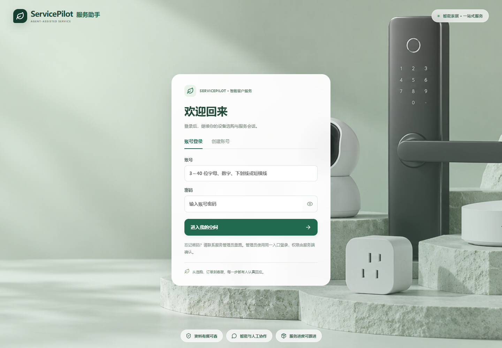
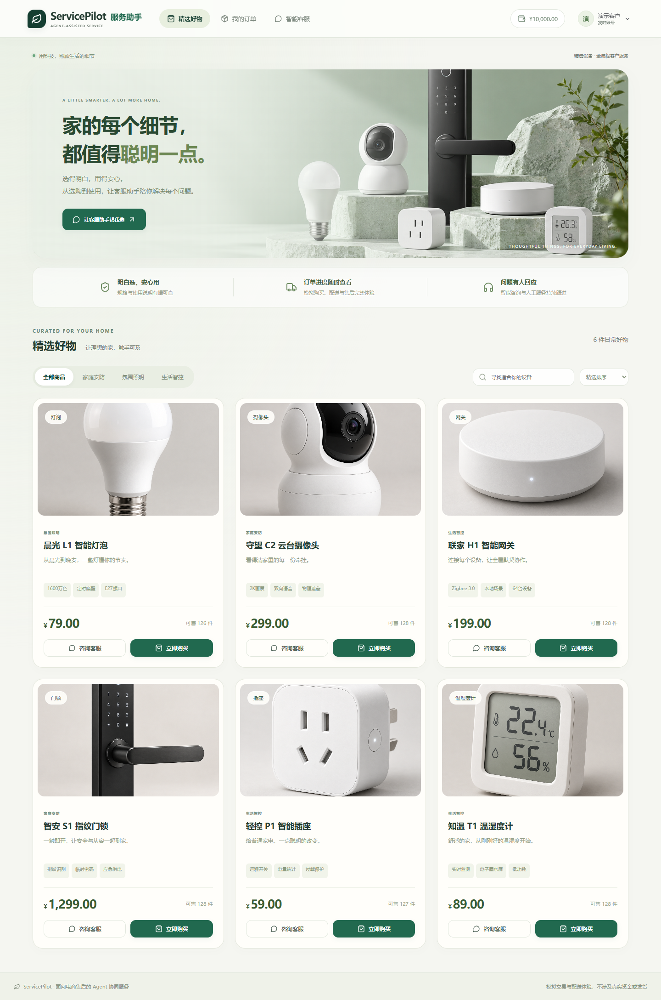
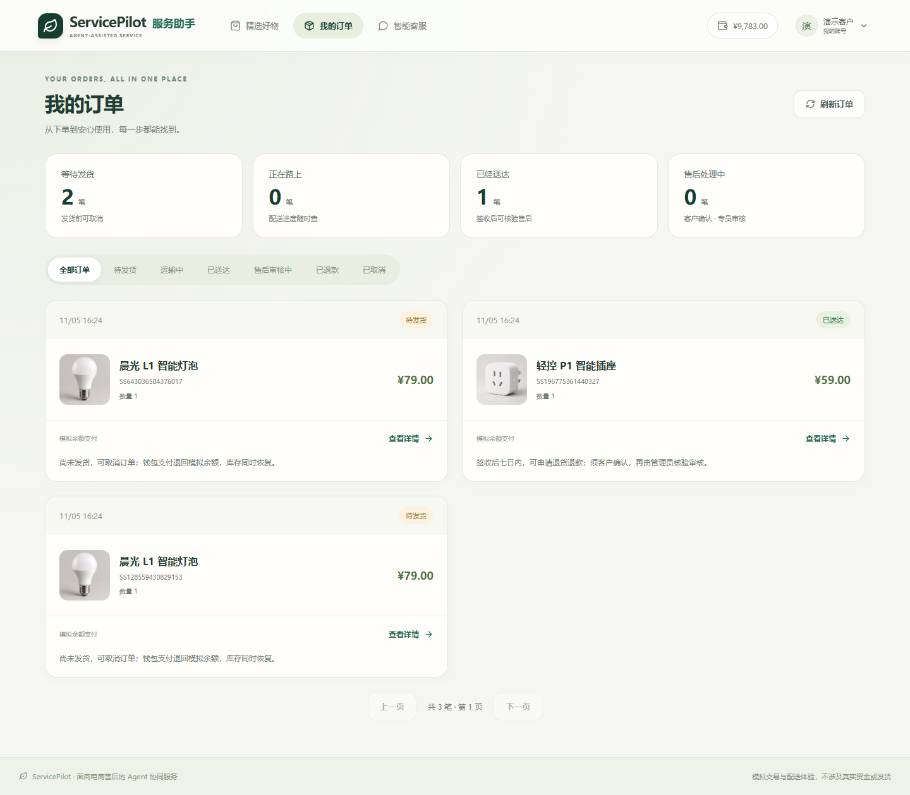

# ServicePilot

**面向电商售后的 Agent 协同服务系统**

[](https://github.com/3911425/smartserve/actions/workflows/ci.yml)
[](backend/pom.xml)
[](LICENSE)

ServicePilot 以智能家居商品为演示场景，将知识问答、订单查询、售后建议与人工审核连接起来。产品和售后 Agent 可以选择受限工具获取依据；取消、退款和资金变动由确定性业务服务处理，保留用户确认、权限校验和版本历史。

项目采用 Java 模块化单体架构，包含可运行的模拟交易、Agent 工具循环、RAG、任务恢复和可复现评测。支付、物流与商品品牌均为模拟数据，未连接真实支付机构或承运商。

[快速启动](#快速启动) · [架构与数据模型](docs/03-架构与数据模型.md) · [Agent / RAG](docs/04-Agent与RAG实现.md) · [测试与评测](docs/06-评测与验证报告.md) · [完整文档](docs/README.md)

## 业务与工程设计

| 关注点 | 实现方式 |
| --- | --- |
| 模型建议与交易权限分离 | `prepareRefund` / `prepareCancellation` 只读；客户确认后提交业务请求，管理员审核后才返还模拟余额 |
| 统一售后边界 | `OrderServicePolicy` 为页面、工具和写接口提供统一规则；待发货取消、运输中人工核验、有效签收窗口内退货 |
| 交易正确性 | 条件扣库存/余额、数据库事务、请求键及内容校验、唯一资金流水；撤回/驳回可重提，旧版本不能确认新申请 |
| 可追溯知识回答 | 本地 BGE-small-zh 512维，向量/BM25/RRF融合，产品范围过滤、证据门槛、引用及工具事实核验 |
| 可恢复客服任务 | 本地工作池或RabbitMQ，DB持久任务、CAS领取、租约与检查点；SSE按事件游标续读 |
| 可观测与可评测 | 逐次模型请求记录、已知Token/耗时、本地AgentOps、可选LangSmith导出；检索集和任务集分别回归 |

## 一条售后链路

1. 客户注册后获得一次性模拟余额，购买商品，生成持久化的待发货/运输中/已送达场景。
2. 客户询问“这笔订单能退吗”，售后Agent查询本人订单、核验规则，给出依据和建议。
3. 待发货订单由客户核对后取消；已送达且在窗口内的订单可填写原因、准备申请并确认当前版本。
4. 管理员审核，业务事务处理状态、钱包与流水；撤回、驳回、重提和审核均留历史。
5. 无法自动处理的问题由客户确认提交服务单，管理员处理结果回写原会话。

明确完整订单号的纯物流查询可走确定性节点，**无需远程模型请求**。模型开启时，产品和售后领域使用有界工具决策循环；并非每个图节点都是自主Agent。

## 系统结构



后端及Agent均用Java；Spring Boot 3.5.6、LangChain4j 0.36.2、LangGraph4j 1.8.20；持久化为JdbcTemplate与Flyway。前端为Vue 3、TypeScript、Element Plus、Vite 6。默认远程模型配置为TokenDance的 `deepseek-v4.1-flash`，可替换兼容端点；Embedding在本地执行。

## 页面预览

以下为隔离H2环境的离线演示，轨迹中的0次模型请求与实际配置一致。





<details>
<summary>查看登录、商城与订单页面</summary>







</details>

## 快速启动

### Docker Compose

以下命令适用于Windows PowerShell，需先启动Docker Desktop。默认离线模式无需模型Key，保留本地BGE、检索、工具与业务流程。

```powershell
git clone https://github.com/3911425/smartserve.git
cd smartserve
powershell -ExecutionPolicy Bypass -File scripts/init-env.ps1
docker compose --profile app up -d --build
```

访问 **http://localhost:5173**。管理员用户名默认 `admin`，初始化密码读取本地 `.env` 中 `BOOTSTRAP_ADMIN_PASSWORD` 的值；客户可自行注册。初始化只创建缺失账号，不覆盖已有数据库中的密码。

Linux/macOS可复制 `.env.example` 为 `.env`，填写四项账号/服务秘密后执行同一Compose命令，详见[启动与账号](docs/01-启动与账号.md)。镜像与依赖首次下载需要网络，BGE加载完成后才可使用检索。

```powershell
docker compose --profile app ps
docker compose --profile app logs -f backend
docker compose --profile app down
```

`down`保留数据卷；添加 `-v` 会删除卷。项目PG/Redis映射到本机15432/16379，避免占用已有5432/6379实例。

### 无Docker体验

安装Java 17/21、Maven 3.9、Node.js 22后，在仓库根目录执行：

```powershell
powershell -ExecutionPolicy Bypass -File scripts/start.ps1 -Mode demo -Offline
# 停止
powershell -ExecutionPolicy Bypass -File scripts/stop.ps1
```

该方式使用H2文件库、JVM余弦与本地工作池。连接本机PG、Docker基础设施或真实模型的说明见[运行指南](docs/01-启动与账号.md)。

## 验证与复现

本次H2回归通过43项核心测试和2项模型协议测试，离线Agent回归32/32通过。历史基线包含43项核心测试在H2和两套PostgreSQL中的回归、2项模型协议测试、2项基础设施测试，以及32条离线Agent结构回归。相同用例跨数据库执行不重复计算为不同测试；模型协议桩也不代表真实模型质量。

固定检索集为72条（56正例、16负例），2026-11-05的混合Recall@5为98.21%，负例误接受0/16。该数字是小规模自建集的检索指标，**不是答案准确率**。当前发布验证及知识revision、指标定义、原始记录见[评测报告](docs/06-评测与验证报告.md)；CI会重新构建并执行离线回归。

```powershell
cd backend
mvn verify
cd ../frontend
npm ci
npm run build
```

运行检索/任务评测需隔离服务，复现命令见报告。默认不使用付费模型；在线评测需显式开启并单独统计调用。

## 文档与边界

从[文档索引](docs/README.md)进入业务、架构、Agent/RAG、API、评测、部署和[技术路线](docs/ROADMAP.md)。

当前未实现真实支付/物流、部分退款、公开在线演示服务、多模态和微服务；未完成生产容量、多实例故障和备份恢复验收。领域循环中断后可能重跑节点，外部模型不保证恰好调用一次，取消在途请求也不保证零费用。

项目原名SmartServe；为兼容已有简历链接、配置和数据，仓库路径 `smartserve`、Java包名、环境变量及Docker卷名沿用原标识。代码与原创资料使用[MIT许可证](LICENSE)。
