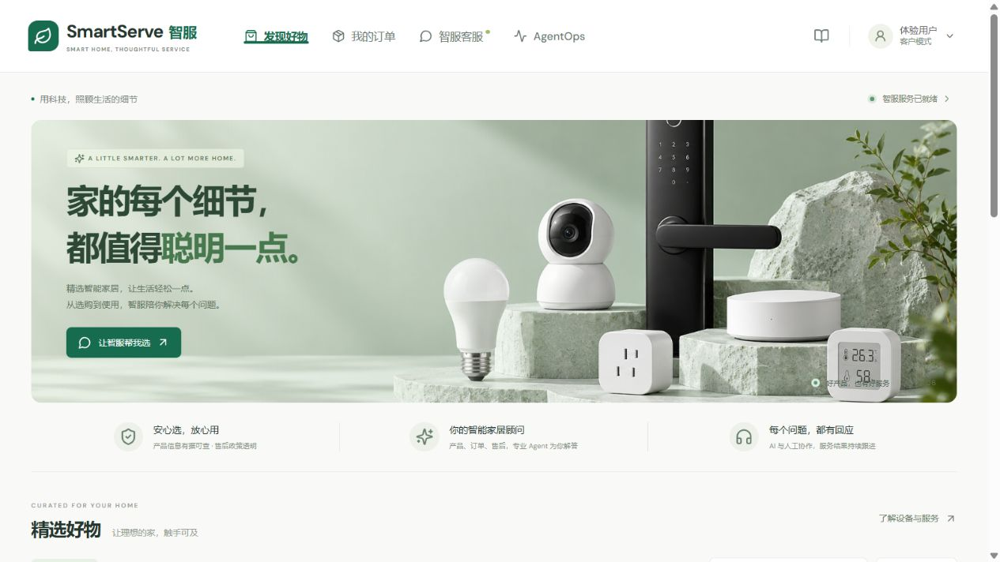
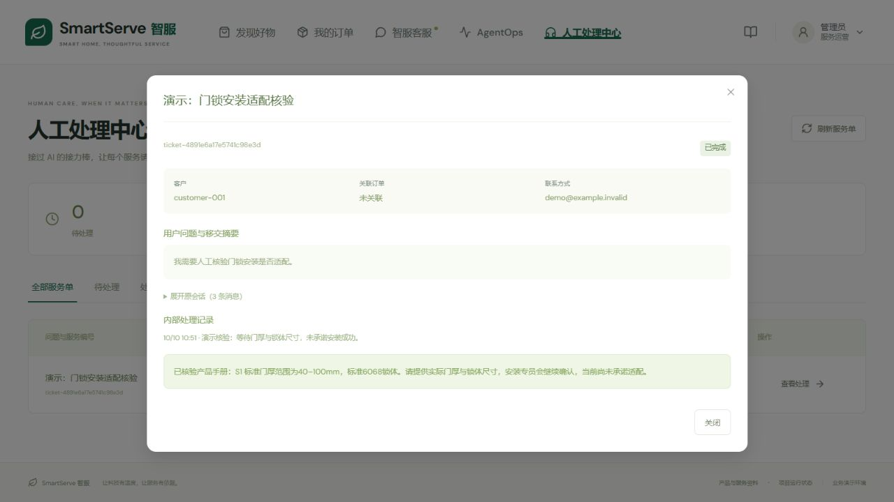
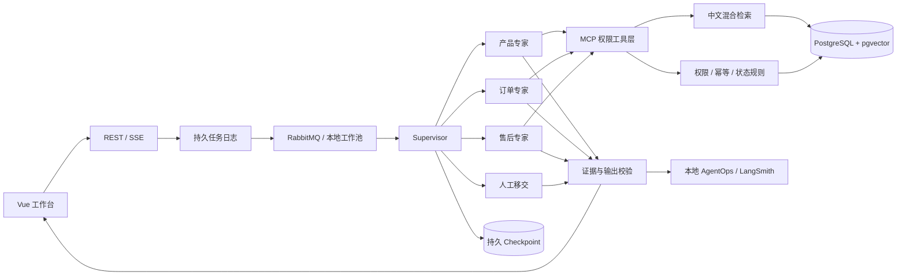

# SmartServe · 智服

**Multi-Agent Customer Service Hub for Smart Home**

[GitHub 代码仓库](https://github.com/3911425/smartserve) · [从这里开始运行](docs/running.md) · [读代码指南](docs/code-tour.md)

一个围绕真实业务约束设计的智能家居客服项目：产品问答有证据，订单查询有权限，退款申请有确认和幂等，人工处理有回写，Agent 执行有追踪。


## 可以做什么

- **发现好物**：六款虚构智能家居产品、分类、搜索、价格排序、收藏、商品详情与一键咨询。
- **我的订单**：客户只看自己的样例订单；管理员可查看全部。物流事实来自业务数据库。
- **智服客服**：Supervisor 分配产品、订单、售后与人工移交任务；通过 MCP 调用域内工具。会话历史可恢复。
- **证据问答**：本地中文 BGE ONNX Embedding，向量与 BM25 式词法检索、RRF 融合、加权重排、证据门槛、引用白名单与独立模型审查。无依据时拒答并提供升级单表单。
- **售后闭环**：先生成待确认退款草稿；用户确认后才改变订单状态。订单行锁与数据库唯一约束抵御并发重复申请。资金处理明确为模拟。
- **服务升级单**：表单确认 → 待处理 → 管理员认领 → 已完成 → 原会话收到人工结果。内部备注对客户隐藏。
- **AgentOps**：真实运行统计、路由、工具调用、检索证据、校验、Token 和耗时。LangSmith 可导出脱敏追踪。
- **可靠执行**：任务持久化、有限工作池、RabbitMQ 配置、持久化 LangGraph4j Checkpoint、SSE 重连与事件补发、模型重试与证据降级。

## 技术栈

| 层         | 实现                                                               |
| ---------- | ------------------------------------------------------------------ |
| 后端       | Java 21 / Spring Boot 3.5.6；本机 Java 17 自动兼容                 |
| 编排与模型 | LangGraph4j 1.8.20 / LangChain4j 0.36.2 / DeepSeek OpenAI 兼容接口 |
| 检索       | bge-small-zh，512 维，ONNX 本地推理；PostgreSQL 16 + pgvector      |
| 状态与业务 | JDBC，任务与会话持久化，原生 CheckpointSaver                       |
| 缓存与异步 | Redis 7.4 / RabbitMQ / 本地有限工作池                              |
| 工具       | MCP Streamable HTTP 的无状态 JSON 响应模式，JSON-RPC 2.0           |
| 观测       | 应用事件日志 / SSE / LangSmith REST 脱敏导出                       |
| 前端       | Vue 3 / TypeScript / Element Plus / Lucide / Vite                  |
| 部署       | Docker Compose；Windows 本地启停脚本；GitHub Actions               |

版本被固定在可构建的组合，升级时应同步验证兼容性。重排是可解释的语义与词法加权算法，尚未接入神经 Cross-Encoder；未把它描述成训练过的 Reranker。

## 快速运行：本机体验

当前这台电脑已配置 `postgres-local`：使用你的本机 PostgreSQL `smartserve` 库；数据库密码只在本地 `.env`。未安装 pgvector 时明确使用 JVM 余弦检索，完整标准栈另有配置。详细说明见 [运行指南](docs/running.md)。

你的电脑已有 Java、Maven 和 Node 时，先用本地演示配置跑通整条链路。此模式使用 **H2 文件数据库 + JVM 余弦检索 + 本地工作池**，不用先安装 Docker；它是开发便利配置，正式栈仍使用 PostgreSQL、Redis、RabbitMQ。

```powershell
cd E:\SmartServe
Copy-Item .env.example .env  # 仅首次；已有 .env 时不要覆盖
# 编辑 .env：填入密钥，真实模型设 LLM_ENABLED=true。
powershell -ExecutionPolicy Bypass -File scripts/start.ps1
```

打开 **http://localhost:5173**。首次加载中文模型与文档索引需要一些时间。API：http://localhost:8080/api/status。

没有 Key 或想先看业务，可以：

```powershell
powershell -ExecutionPolicy Bypass -File scripts/start.ps1 -Offline
```

离线模式使用真实检索证据和确定性业务逻辑，不模拟 LLM 用量。停止：

```powershell
powershell -ExecutionPolicy Bypass -File scripts/stop.ps1
```

已有构建可添加 `-SkipBuild`。脚本生成的 PID、日志与依赖缓存在 `.local/`，不会上传。

## 标准栈：一条命令启动五个服务

安装 Docker Desktop 并启动后，在根目录准备 `.env`：

```powershell
docker compose --profile app up -d --build
```

打开 http://localhost:5173。Compose 启动 PostgreSQL + pgvector、Redis、RabbitMQ、Java 后端、Nginx 前端。数据放在具名 Docker 卷，文档和图片从 `data/` 只读挂载。

只启动基础设施、在 IDEA 调试：

```powershell
docker compose up -d
cd backend
mvn spring-boot:run -Dspring-boot.run.profiles=postgres
# 第二个终端
cd frontend
npm ci
npm run dev
```

RabbitMQ 管理页：http://localhost:15672，账户来自 `.env`。关闭服务用 `docker compose --profile app down`；**不要加 `-v`，它会删除数据库卷**。

## 先体验这三条完整链路

1. 商城点击门锁「咨询智服」；发送「门锁没电了怎么应急开门？」；展开来源，再在 AgentOps 查看 MCP 与检索记录。
2. 我的订单 → `SS20261010001` → 申请售后；核对金额并确认。重复申请返回同一退款记录，不会产生第二条资金意图。
3. 问「我要转人工处理安装问题」→ 填写服务升级单并确认 → 切管理员 → 认领 → 填写结果 → 完成 → 切回客户并打开原会话查看人工回复。

模拟订单相对首次初始化日期生成；数据库保留后时间窗口会自然推进。想重新演示退款，优先新增测试订单，不要随意删除数据库。

## 界面截图





## 系统结构



## 文档与学习路径

| 文档                                               | 内容                                   |
| -------------------------------------------------- | -------------------------------------- |
| [运行与 IDEA 指南](docs/running.md)                | 环境、端口、启动顺序、配置、常见错误   |
| [代码阅读与讲解](docs/code-tour.md)                | 按一次请求的路径读代码，练习与面试问答 |
| [产品需求与业务规则](docs/product-requirements.md) | 用户、流程、验收标准、边界             |
| [架构设计](docs/architecture.md)                   | 状态图、MCP、存储、记忆、质量护栏      |
| [数据设计](docs/data-model.md)                     | 表、索引、幂等、数据生命周期           |
| [API 说明](docs/api.md)                            | REST、SSE、MCP、错误码与样例           |
| [可靠性与安全](docs/reliability-security.md)       | 重试、恢复、租约、权限、隐私与限制     |
| [测试与评估](docs/evaluation.md)                   | 测试证据、检索基线、RAGAS、待验证项    |
| [部署与运维](docs/operations.md)                   | 健康、备份、故障处理、正式部署检查     |
| [设计决策记录](docs/decisions.md)                  | 选择与放弃的技术，原因与代价           |
| [演示与简历表达](docs/demo-and-interview.md)       | 五分钟讲述、准确描述贡献、下一步练习   |

## 构建和测试

```powershell
cd backend
mvn verify
cd ../frontend
npm ci
npm run build
```

集成测试包括中文语义检索、未知问题拒答、MCP Agent 权限、跨用户访问、16 个并发退款请求、重复确认、工单状态与回写、签名篡改、持久检查点。测试不调用付费 LLM。

## 实现边界

这是一套能本地运行、适合学习和演示的工程项目。它没有接真实支付、物流商、仓库、短信或商业身份认证。演示角色切换默认开启；正式部署应关闭 `DEMO_ACCESS` 并接入真实身份服务。目前只有预配置客户/管理员凭证接口，尚未实现完整多租户身份平台。

没有宣称百万并发、生产 SLA 或虚构 RAGAS 分数。RabbitMQ/Redis/pgvector 的配置与代码已提供，本机未安装 Docker 时，其集成效果须在标准环境进一步验证。详细验证记录见评估文档。

## 仓库说明

`.env`、运行数据库、日志、构建产物与依赖不进入 Git。只上传 `.env.example`。业务文档是项目原创虚构资料；商品与横幅图片由 ImageGen 生成，均保存在 `data/images/`。MIT 许可证适用于本仓库代码与原创文档，第三方依赖保留各自许可证。
