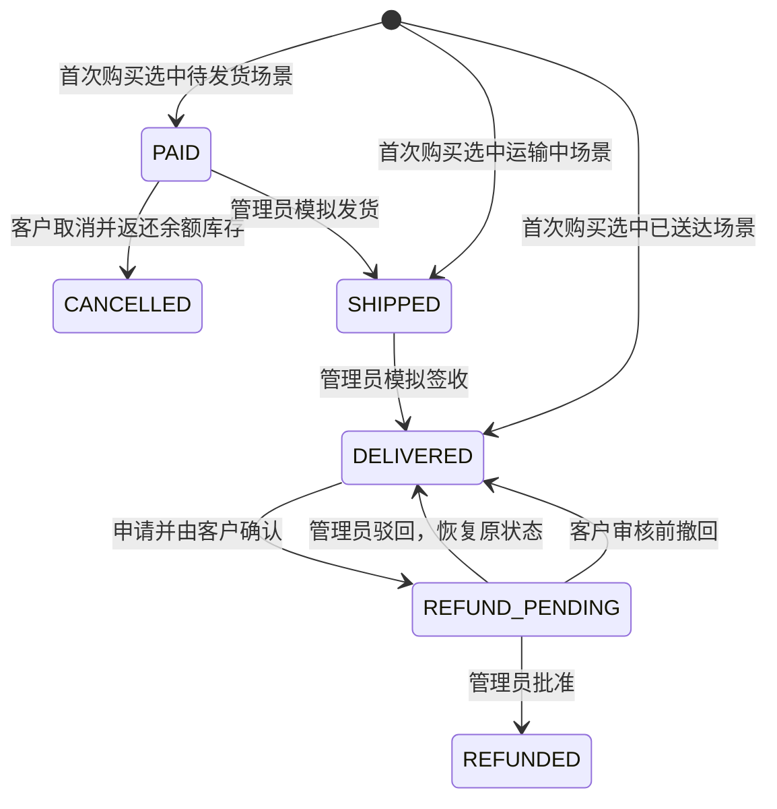

# 产品与业务规则

更新：2026-10-23 · 适用业务版本 `2.1-20261023`。本页描述当前已实现的规则，后续设想见[技术路线](ROADMAP.md)。

## 产品定位

ServicePilot 是面向电商售后的 Agent 协同服务系统，使用智能家居商品演示选购、订单和售后上下文。主线是“选购有依据、交易有记录、咨询有工具、售后有确认、问题有人接”。AI 客服是重点，商城为它提供真实可核验的业务上下文。本版本仍是模拟业务，不处理真实货款或真实物流。

客户拥有商品目录、本人订单、模拟钱包、客服会话、资料与密码。管理员拥有按客户查询订单、推进模拟物流、退款审核、人工服务和答案反馈复核。管理员由后端账户表决定，不能从前端切换或通过注册请求指定。

## 一次完整体验

1. 注册客户，登录后钱包得到一次10000元模拟余额。
2. 选择 P1 插座，填收货信息，确认购买。钱包减少59元，库存减少1；服务端在本次购买事务中等概率随机生成待发货、运输中、已送达三种模拟场景之一。
3. 问客服“这笔订单的物流”。订单节点查询已经持久化的状态、运单与事件。随机只在首次成功购买时执行一次，刷新、查询与同一请求键重试都不重新随机。
4. 若订单仍待发货或运输中，管理员可按顺序继续模拟发货、签收；已送达场景在购买时已补齐发货、签收时间与顺序事件。这是压缩时间的模拟体验，没有真实承运商。
5. 客户咨询“这笔订单可以退吗”。售后 Agent 查询订单、核验窗口，可能提出退款建议；此时没有申请、没有返款。
6. 客户进入订单详情，填写原因，创建申请，再确认提交。状态变为待管理员审核。
7. 管理员核验并批准。事务返还59元模拟余额，写唯一退款流水；确认退回且可销售才恢复库存。
8. 客户仍有疑问时提交人工服务单。管理员认领、填写内部记录、完成并回写原会话。
9. 客户对 AI 回答提交反馈。管理员归因，维护者审核知识修改，重新索引并跑回归。

## 钱包、库存与订单不变量

- 一次性赠送通过唯一业务流水约束；重新登录、重启都不重新赠送。
- 余额、价格使用 `BigDecimal`/`NUMERIC`，不能用浮点数结算。
- 价格由后端读取商品，不能接受浏览器提交的最终金额。
- 一次购买中扣库存、扣余额、创建订单/条目/流水/事件处于同一事务，任一失败全部回滚。
- 同一用户同一请求键重复相同输入，返回原订单；修改输入则409。幂等键不是“全局禁止买第二次”，新的一次购买需要新键。
- 数据库限制余额和库存非负，条件更新检查影响行数。用户行锁使该客户的钱包操作顺序执行；不同客户仍竞争库存条件更新。
- 订单保存商品和收件信息快照。以后修改个人地址、商品说明，不改变已下订单。

## 状态机

自助退货窗口要求已送达且按北京时间计算签收日差为0至7天，未来日期或缺少签收记录不能通过，不能替代商品质量鉴定。质量争议、安装后退货、超过窗口走人工服务。每单保留一份整单退款记录；被驳回或主动撤回后，仍符合窗口时允许修改原因、重新准备并确认，版本递增，旧原因和审核结论留在 `refund_history`。

三种初始场景各为1/3概率，但连续几笔相同状态是正常的。随机只在新购买首次成功时执行，旧订单不会被重新分配状态；模拟发货、签收时间用于体验完整业务链路，不能当作真实履约时效。

退款申请单独有 `AWAITING_CONFIRMATION → PENDING_REVIEW → REFUNDED/REJECTED` 状态，待确认和待审核都可由本人撤回到 `WITHDRAWN`。创建、确认、批准不能混为一步。客户确认、撤回和管理员审批携带版本，旧页面不能确认重新编辑过的申请；同结论重复审核幂等，相反结论返回409。库存恢复要求管理员明确确认，不把“退款”自动等同于“退回可售”。

待发货的取消退款是独立的自助路径，不需要先转人工；运输中的拦截、异常和未签收退货须人工核验，不能伪装成签收后自助退货。订单响应中的 `serviceOptions` 是页面按钮、Agent工具和业务校验共同遵守的规则。物流摘要只读取支付、发货和签收事件，售后审核不冒充物流变化。

## 旧数据迁移

原有 `customer_order` 留作迁移来源，新业务使用 `shop_order`。历史订单标记 `LEGACY_DEMO`，首次客户仍保留初始10000元。这类订单没从钱包付款，因此取消/退款不能向钱包造钱，售后批准也不恢复本版本库存。其他旧订单所属用户建为禁用归档账户，不能猜一个密码登录别人的历史记录。

迁移是新增结构和复制，不删除原有业务库。Flyway 当前有 V1 基础表、V2 账户交易结构、V3 退款版本历史表；未受 Flyway 管理的旧库先基线到0，再执行兼容迁移。V3 为已有退款补当前快照，不能凭空恢复升级前已被覆盖的旧原因。正式数据操作前仍需备份，不能把“迁移脚本存在”等同于“所有历史数据类型均已验证”。

## 人工服务与答案反馈

工单由用户确认提交，状态为待处理→处理中→完成。内部备注不对客户返回，完成结论回写原会话。它是异步服务单，不是实时在线客服。没有真实排班或SLA计时器。

工单按用户、会话和请求键去重：相同内容重试返回原工单，同键修改订单、标题、详情、联系方式或优先级返回409。管理员处理工单，不代替客户创建工单、购买、取消或确认退款。

反馈针对已完成的本人回答，支持有用/未解决及说明。反馈进入人工复核，**不会自动写知识或训练模型**。处理归因应区分：缺文档、检索未命中、错误型号、工具失败、生成越界、规则缺口。修复需要带上失败用例再次验证。

## 目前明确不包含

真实支付/对账回调、真实承运商、购物车和优惠券、部分退款、商品后台增删改、评论推荐、邮件短信找回、多模态、微服务。不存在的功能不能靠 UI 文案或模型承诺补齐。发展路线说明后续何时值得引入。
