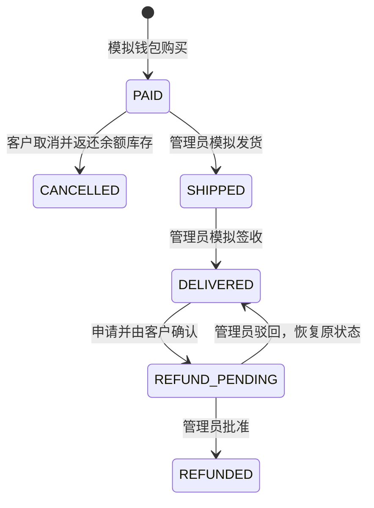

# 产品与业务规则

## 产品定位

SmartServe 智服是智能家居商城与客户服务平台。主线是“选购有依据、交易有记录、咨询有工具、售后有确认、问题有人接”。AI 客服是重点，商城为它提供真实可核验的业务上下文。本版本仍是模拟业务，不处理真实货款或真实物流。

客户拥有商品目录、本人订单、模拟钱包、客服会话、资料与密码。管理员拥有按客户查询订单、推进模拟物流、退款审核、人工服务和答案反馈复核。管理员由后端账户表决定，不能从前端切换或通过注册请求指定。

## 一次完整体验

1. 注册客户，登录后钱包得到一次10000元模拟余额。
2. 选择 P1 插座，填收货信息，确认购买。钱包减少59元，库存减少1，生成待发货订单。
3. 问客服“这笔订单的物流”。订单节点查询本人订单，返回稳定的待发货状态；不会随机造物流。
4. 管理员在客户目录进入该客户订单，先模拟发货，再模拟签收，事件记录留在订单详情。
5. 客户咨询“这笔订单可以退吗”。售后 Agent 查询订单、核验窗口，可能提出退款建议；此时没有申请、没有返款。
6. 客户进入订单详情，填写原因，创建申请，再确认提交。状态变为待管理员审核。
7. 管理员核验并批准。事务返还59元模拟余额，写唯一退款流水；确认退回且可销售才恢复库存。
8. 客户仍有疑问时提交人工服务单。管理员认领、填写内部记录、完成并回写原会话。
9. 客户对 AI 回答提交反馈。管理员归因，维护者审核知识修改，重新索引并跑回归。

## 钱包、库存与订单不变量

- 一次性赠送通过唯一业务流水约束；重新登录、重启都不重新赠送。
- 余额、价格使用 `BigDecimal`/`NUMERIC`，不能用浮点数结算。
- 价格由后端读取商品，不能接受浏览器提交的最终金额。
- 一次购买中扣库存、扣余额、创建订单/条目/流水/事件处于同一事务，任一失败全部回滚。
- 同一用户同一请求键重复相同输入，返回原订单；修改输入则409。幂等键不是“全局禁止买第二次”，新的一次购买需要新键。
- 数据库限制余额和库存非负，条件更新检查影响行数。用户行锁使该客户的钱包操作顺序执行；不同客户仍竞争库存条件更新。
- 订单保存商品和收件信息快照。以后修改个人地址、商品说明，不改变已下订单。

## 状态机

自动退货窗口只检查已送达状态和签收后7日，不能替代商品质量鉴定。质量争议、安装后退货、超过窗口走人工服务。每单只有一个整单退款申请，已驳回需要补材料时走工单，不自动新增第二份退款。

退款申请单独有 `AWAITING_CONFIRMATION → PENDING_REVIEW → REFUNDED/REJECTED` 状态。创建、确认、批准不能混为一步。管理员审批使用版本检查防止操作过期记录；重复终态审核不会重复返款。库存恢复要求管理员明确确认，不把“退款”自动等同于“退回可售”。

## 旧数据迁移

原有 `customer_order` 留作迁移来源，新业务使用 `shop_order`。历史订单标记 `LEGACY_DEMO`，首次客户仍保留初始10000元。这类订单没从钱包付款，因此取消/退款不能向钱包造钱，售后批准也不恢复本版本库存。其他旧订单所属用户建为禁用归档账户，不能猜一个密码登录别人的历史记录。

迁移是新增结构和复制，不删除原有业务库。新环境用 Flyway 建库，已有 V1 库先基线到0再执行幂等兼容迁移。正式数据操作前仍需备份，不能把“迁移脚本存在”等同于“所有历史数据类型均已验证”。

## 人工服务与答案反馈

工单由用户确认提交，状态为待处理→处理中→完成。内部备注不对客户返回，完成结论回写原会话。它是异步服务单，不是实时在线客服。没有真实排班或SLA计时器。

反馈针对已完成的本人回答，支持有用/未解决及说明。反馈进入人工复核，**不会自动写知识或训练模型**。处理归因应区分：缺文档、检索未命中、错误型号、工具失败、生成越界、规则缺口。修复需要带上失败用例再次验证。

## 目前明确不包含

真实支付/对账回调、真实承运商、购物车和优惠券、部分退款、退款重提、商品后台增删改、评论推荐、邮件短信找回、多模态、微服务。不存在的功能不能靠 UI 文案或模型承诺补齐。发展路线说明后续何时值得引入。
