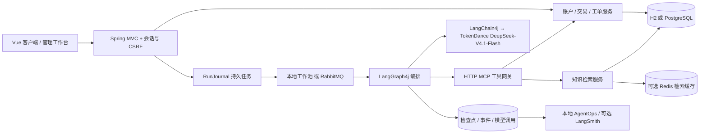

# 架构与数据模型

## 一张图看清职责

业务仍在一个 Spring Boot 应用中，没有以 MCP 端点或一个数据库表冒称微服务。MCP 是工具协议边界；LangGraph4j 是执行状态与路由；LangChain4j 是模型和消息/工具格式接口。两个有自主决策循环的领域 Agent 与确定性订单节点共同组成受控客服图，不能把所有节点都叫自主 Agent。

## 一个购买事务的线路

浏览器生成请求键→POST `/purchases`→会话过滤器取得真实用户→校验 DTO→`CommerceService.purchase` 开启事务→锁客户行→检查相同请求键→查询商品及服务端价格→条件扣库存→条件扣余额→保存订单快照和条目→写唯一流水与订单事件→提交→返回订单。它不经过 MQ、不调用远程模型、不依赖 Redis。

数据库提供一致性，前端按钮禁用仅改善体验。应用中断在事务提交前，整笔回滚；提交后响应丢失，客户端以同键重试找到原订单。客户端如果擅自换新键，则代表新业务请求，后端无法凭空判断是不是误点，因此要保留原键直至确认结果。

## 一次客服请求的线路

会话校验→创建 `agent_run=QUEUED` 和用户消息→事务提交→投递 runId→消费者 CAS 领取90秒租约→进入执行范围→读取最近最多9条消息、裁剪到6000字符→图节点执行及保存检查点→通过 HTTP MCP 调业务/检索→逐次记录模型尝试→护栏→持租约提交结果和助手消息→客户端通过 SSE 事件游标获取进度并读取结果。

RabbitMQ 消息只放 **runId 字符串**。问题正文、身份、状态和恢复位置在数据库中，避免把缓存/队列当主数据源。任务表兼作持久投递清单：投递失败或工作池满，任务仍为QUEUED，5秒恢复扫描再次投递。重复消息由 `QUEUED→RUNNING` 条件更新排除重复领取。

运行中每10秒续租；租约90秒，最多3次领取。超时后可重新入队；旧执行者即使稍后收到模型结果，也不能覆盖新拥有者。检查点、完成提交都检查租约。**不保证外部模型恰好调用一次**：崩溃恢复可能重发请求，已经发出的请求也可能计费；资金工具因此没有交给 Agent。

## 表与职责

| 表                          | 关键字段 / 约束                                          | 用途                          |
| --------------------------- | -------------------------------------------------------- | ----------------------------- |
| user_account                | 唯一username、password_hash、role、enabled、locked_until | 后端身份和登录锁定            |
| auth_session                | token_hash、user_id、expires_at                          | 会话撤销与过期，原token不入库 |
| wallet                      | user_id主键、balance≥0、version                          | 模拟钱包主账                  |
| wallet_ledger               | 唯一business_key、kind、amount、balance_after            | 赠送/支付/取消/退款的资金凭据 |
| product / product_inventory | 商品JSON目录 / available≥0                               | 展示资料与并发可售库存分开    |
| shop_order / order_item     | 用户+请求键唯一、request_hash、快照、version             | 新版交易主表和条目            |
| order_event                 | order_id、status、描述、操作人、时间                     | 持久状态轨迹                  |
| refund_request              | order_id唯一、确认/审核时间、reviewer、version           | 整单售后闭环                  |
| conversation / chat_message | owner_id、conversation_id、metadata                      | 历史会话与消息                |
| escalation_ticket           | 状态、version、内部备注、处理结果                        | 异步人工服务                  |
| agent_run                   | 状态、租约token/期限、领取次数、payload                  | 持久任务和最终结果            |
| graph_checkpoint            | thread_id、节点、状态、下一节点                          | LangGraph4j恢复位置           |
| run_event                   | 自增id、run_id、event_type、payload                      | SSE游标与本地审计             |
| model_call                  | 节点、用途、attempt、状态、可空Token、耗时               | 每次 SDK 请求的真实记录       |
| knowledge_chunk             | 来源、标题、正文、模型/版本、产品范围、向量              | 可追溯知识索引                |
| answer_feedback             | run_id、user_id、helpful、复核状态/说明                  | 人工改进入口                  |

`customer_order` 是兼容旧版迁移表，不再承担新购买写入。部分既有会话/商品数据仍为JSON，并没有全项目“纯关系模型化”；订单、库存和钱这些强约束部分优先结构化。

## 索引与存储的实际边界

Postgres模式建立 `vector(512)` 和余弦HNSW索引；小知识库查询计划可能选择顺序扫描，应以 EXPLAIN 为准。JVM模式启动时加载分块向量，逐个计算余弦。当前词法 BM25 仍在应用内存对小语料计算，不是 Elasticsearch。

Redis只缓存检索结果15分钟，键包含知识内容/模型/策略版本、策略、问题哈希和TopK。余额、库存、订单权限不走该缓存。Redis失败时回源重算，不能影响已提交交易；旧revision缓存可以自然过期。

本版本每个后端实例持有自己的知识快照和本地线程池、模型并发信号量、SSE连接上限。它们是单实例限制，不能宣称集群全局限流。RabbitMQ/租约结构为后续多实例提供基础，但尚未做多实例容量和故障验收。
