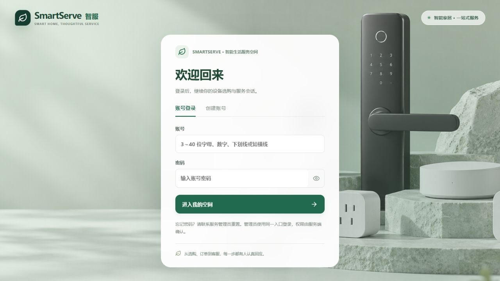
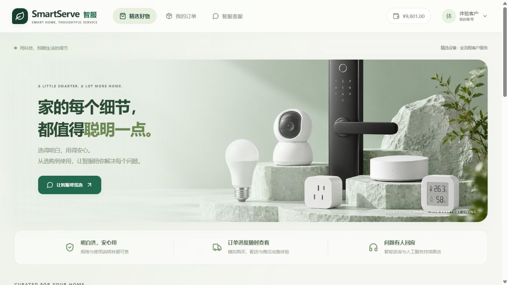
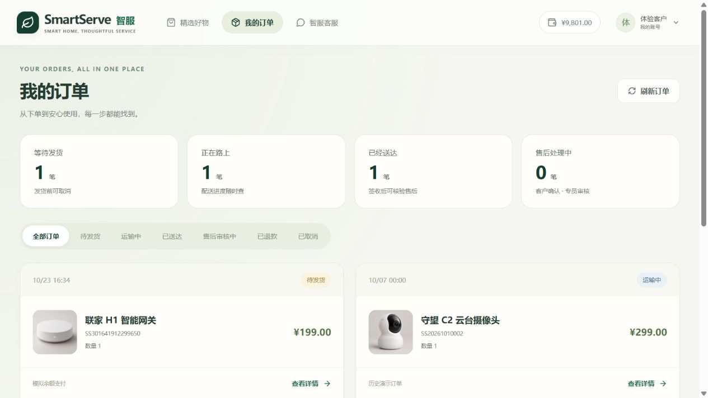

# 业务一致性修复与验收 · 2026-10-23

业务协议版本：`2.1-20261023`。本次检查覆盖账号与权限、购买事务、模拟配送、取消、售后申请/确认/撤回/审核、人工服务单、Agent 工具、页面入口，以及三种常用运行方式。以下只列实际完成的修复和验证，不把回归通过等同于正式上线验收。

## 购买后配送怎样随机

购买事务首次成功时，服务端等概率选取一种场景。随机结果与扣余额、扣库存、订单快照、资金流水、配送事件一起提交；失败会回滚。同一购买请求键重试返回原订单，不重新扣款或随机。

| 初始场景 | 写入的配送事实 | 客户可以办理 |
| --- | --- | --- |
| 待发货 PAID | 支付成功事件；无运单、发货或签收时间 | 核对后取消，钱包支付返还余额和库存 |
| 运输中 SHIPPED | 支付→揽收事件；模拟运单与发货时间 | 查询物流；拦截、异常由人工核验，不能直接按已签收退货 |
| 已送达 DELIVERED | 支付→揽收→签收事件；运单、发货与签收时间齐全 | 签收日差0至7天内可准备退货申请，确认后等待审核 |

这些是压缩时间的模拟场景，未连接真实承运商。管理员仍可顺序推进待发货→运输中→已送达。旧订单保留原状态，不因本次升级重新抽签；连续几笔新订单状态相同也可能发生，不能把等概率理解为每三笔必定各一种。

代码入口：`FulfillmentSimulator` 只负责选择一次场景；`CommerceService.purchase` 负责事务和事实落库。订单读取和 Agent 查询不执行随机。

## 售后边界统一在哪里

`OrderServicePolicy` 给出 `serviceOptions`，包含能否取消、申请退货、确认和撤回，以及原因说明。订单页面、售后工具和业务写接口遵守同一套判断，页面不再只凭 DELIVERED 状态显示退货按钮。

- 待发货退款诉求提供取消建议和订单入口，不直接转人工；Agent 的 `prepareCancellation` 是只读建议，取消仍由本人在界面确认。
- 运输中不能直接取消或伪装成已签收退货，拦截与异常走人工核验。
- 自助退货要求订单已签收，按北京时间计算签收日差为0至7；未来时间、无签收记录或超过窗口都不通过。窗口只核验状态和日期，不替代验货。
- 准备申请为 AWAITING_CONFIRMATION，客户确认后才成为 PENDING_REVIEW；此时余额未返还。管理员核验通过后才在事务中退款。
- 待确认、待审核均可撤回，撤回不发生退款。撤回或驳回后仍符合窗口，可以补充原因并重新准备、确认，复用原申请编号并递增版本。
- 客户确认、撤回和管理员审核携带版本。旧页面不能确认后来修改过的申请；同结论的重复审核不会重复返款，相反审核结论返回409。
- `refund_history` 保留各版本状态、原因与审核说明，重新申请不会抹去上次驳回记录。V3迁移是新增历史表，并为已有申请补一份当前快照，不重建业务库。
- 历史演示订单未从钱包付款，取消和退款均不增加钱包余额，也不恢复本版本库存。

物流摘要只选支付、发货、签收事件；申请和审核记录仍显示在服务时间线，但不再被当成最新物流。

另修复了服务单同键不同内容未报冲突、管理员代客户提交服务单、订单分页总数不准确，以及快速切换筛选/客户/会话时旧响应覆盖当前内容的问题。

## 怎样避免启动方式使用不同版本

1. 本机方式和混合方式复用同一个 `start.ps1`。`-SkipBuild` 会核对后端源码和 JAR 的 SHA-256 构建记录，不一致就自动重建；构建期间源码变化则拒绝启动。
2. 前端启动时检查后端 `businessRulesVersion`，协议不一致时阻止进入并提示更新整套应用。
3. Docker 后端与前端均已从当前源码重建，旧应用容器已更新；构建不再额外预解析无关的全部 Maven 插件依赖。本次补充了本机已有公开依赖到 Docker 缓存，最终仍在容器内执行源码编译。
4. 应用和 PostgreSQL 会话统一使用北京时间，避免 Windows 与 Linux 容器对无时区时间字段和售后自然日的解释不同。
5. 业务数据库仍然独立：常用一本机 PG；常用二、三共用 Docker PG。相同规则不代表两套数据库中的订单或余额自动同步。

## 实际验证结果

| 验证 | 结果 | 证据 |
| --- | --- | --- |
| H2业务与模型工具协议 | 45项通过，0失败/错误 | `.local/logic-fix-final.log`：43项核心测试和2项模型协议测试 |
| 本机 PostgreSQL | 同一组43项核心测试通过 | [跨数据库回归](../data/evaluation/results/business-modes.json)；全新隔离库，非业务库 |
| Docker PostgreSQL + pgvector | 同一组43项核心测试通过 | 同上；包括取消、退款、权限、并发与离线 Agent |
| Docker Redis/RabbitMQ | 2项通过 | 同上；独立测试队列，不消费业务队列中的任务 |
| HTTP业务闭环 | 11项检查通过 | [业务烟雾测试](../data/evaluation/results/business-smoke.json)，含16次同键购买、并发审核、人工结果回写 |
| 原生随机配送抽样 | 12笔：待发货4、运输中5、已送达3；重试状态稳定 | [抽样与真实售后问答](../data/evaluation/results/fulfillment-online-smoke.json)；不是统计随机性证明 |
| TokenDance售后Agent | 1条真实问答完成，5次模型请求，已知Token 5,347 | 同上；实际调用 queryOrderStatus、prepareCancellation；订单仍待发货、钱包不变、未创建退款申请 |
| 离线Agent回归 | 32/32结构断言通过，0模型请求 | [结果](../data/evaluation/results/agent-offline.json)；不代表在线模型质量 |
| 固定RAG回归 | 72例×3策略，混合Recall@5为98.21%，16个负例误接受为0 | [结果](../data/evaluation/results/retrieval-all.json)；知识revision为6680988e7034，只在隔离H2检索环境测量 |
| 前端 | TypeScript/Vite构建通过；桌面登录、商城、订单概览和详情已检查 | 下方截图；Element Plus分块体积警告仍保留，未声称完成移动端全流程或性能验收 |
| 三种实际启动 | native/hybrid/docker的登录、会话、权限和新规则检查全部通过 | [运行记录](../data/evaluation/results/runtime-modes.json)；native和hybrid的JAR SHA-256完全相同 |

两套业务数据库在迁移前已生成逻辑备份并检查清单，保存在 `.local/backups/before-business-logic-*.dump`；这是备份清单验证，不是恢复演练。V2历史检索与离线任务结果另存 `data/evaluation/results/baseline-v2/`，避免被最新数据冒名替代。在线模型的全面质量评测、容量压测及真实支付/物流接入仍不在本次完成范围。

## 现在如何使用

已恢复常用二：本机前后端连接 Docker PostgreSQL、Redis、RabbitMQ，访问 http://localhost:5173 。应用容器已停止，基础设施保留运行。管理员和迁移客户的密码仍以本机 `.env` 与对应数据库中已设置的值为准；本次没有上传 GitHub。

想体验本次修复，应购买新订单。观察当前状态，再按上面的规则操作；原有待发货订单不会自动改成已送达。正常启停继续使用[启动与账号](01-启动与账号.md)中的常用命令。

以后修改核心业务，可运行 `scripts/test-business-modes.ps1` 重跑两套PG的一致性测试。启动后设置 `SMARTSERVE_BASE_URL=http://127.0.0.1:5173`，运行 `node scripts/verify-runtime.mjs --mode native`（或 hybrid/docker），可复查部署版本和账号；脚本使用 `.env` 中的初始账号凭据，账号在页面改密后须相应提供有效凭据。

## 页面预览

