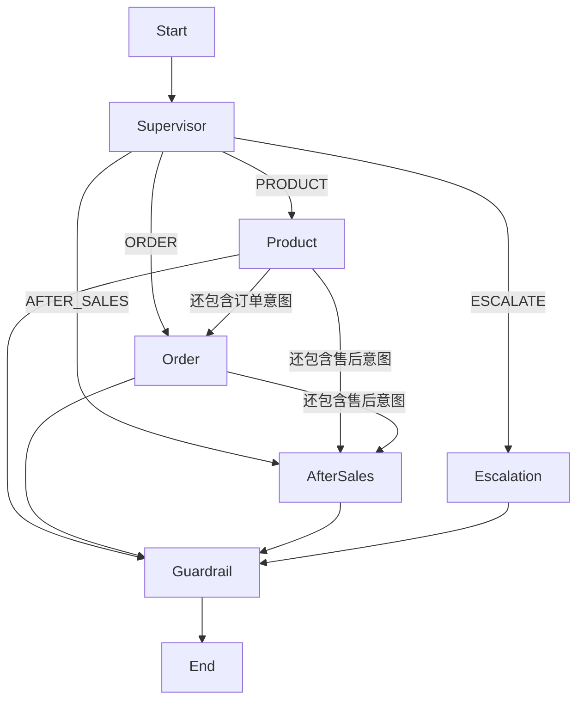

# 架构设计

## 一次请求如何完成

Vue 携带 Bearer 凭证提交问题。API 核对会话归属，锁定会话行，拒绝同会话重叠执行；持久写入 agent_run 和用户消息后提交事务。Controller 再调用 Dispatcher，避免消费者先读到未提交数据。

本地模式进入有限线程池；标准模式向 RabbitMQ durable queue 发送 run_id。消费者用条件更新 QUEUED→RUNNING 获取任务执行权，重复投递不会重复执行。每个节点完成后 LangGraph4j 原生 CheckpointSaver 保存状态，运行日志写入 run_event。

Supervisor 输出有限枚举的业务意图。规则路由始终可用；启用模型时尝试结构化模型路由，格式不合法或服务失败回退规则。复合意图按产品→订单→售后顺序执行，便于每步审计；没有自由群聊和无限自主工具循环。

## Agent 的职责与隔离

| 执行域     | 输入                       | 可调用工具                                                                   | 共享产物               |
| ---------- | -------------------------- | ---------------------------------------------------------------------------- | ---------------------- |
| Supervisor | 有界会话语境、当前问题     | 无业务工具                                                                   | routes 枚举            |
| Product    | 当前问题、必要的指代语境   | searchKnowledge、getProducts                                                 | 产品回答与引用         |
| Order      | 已提取订单号、可信用户身份 | queryOrderStatus                                                             | 确定性订单卡片         |
| AfterSales | 订单号、售后意图           | searchKnowledge、queryOrderStatus、checkRefundEligibility、createRefundDraft | 政策、资格、待确认草稿 |
| Escalation | 越界或人工意图             | 本节点不直接创建工单                                                         | 表单提示，等待客户提交 |
| Guardrail  | 证据和各域产物             | 模型生成/独立审查                                                            | 最终结果与校验状态     |

工具权限由服务端注册表控制，模型不能通过修改 Prompt 获得新工具。售后专家没有 confirmRefund，任何 Agent 都不能执行真实支付。当前是受控域专家节点，模型负责理解与有证据的表达，确定性代码负责业务动作；没有宣称实现任意 ReAct 自治系统。

## MCP 标准化层

工具注册表同时提供名称、描述、参数 JSON Schema、作用域与调用实现。`/api/mcp` 实现 initialize、ping、tools/list、tools/call、初始化通知，使用 JSON-RPC 2.0 和无状态 Streamable HTTP JSON 响应模式。McpBridge 通过实际 HTTP 调用，业务工具不直接散落在模型 Prompt 中。

服务凭证由本地 `.env` 注入，调用携带可信用户与 Agent 上下文。标准 Nginx 阻止客户端访问 MCP 路径。该实现是项目所需的最小协议子集，尚无 OAuth 动态注册、任务协议、订阅或 MCP 官方一致性认证；跨服务生产集成应采用维护中的 SDK 和完整认证。

## 知识摄入与检索

三份 Markdown 是人可读的业务原料。按二级标题划分，再按最多500字符、有50字符重叠切片；来源、标题、内容 SHA-256 和向量保存到 knowledge_chunk。BGE 中文模型在 Java 进程中通过 ONNX 运行，512维，无需另一个 Embedding API Key。

已存在且内容哈希未变的片段复用向量；内容变化重新嵌入，消失的片段删除。索引修订号进入 Redis 缓存键，因此文档变化不会继续使用旧查询结果。元数据 API 提供文档数、片段数、模型、存储和索引修订号。

标准环境使用 pgvector 余弦距离 `<=>` 和 HNSW 索引召回稠密候选。稀疏通道对中文双字、英文数字词计算 BM25 式评分；两个通道的排名做 RRF 融合，再按语义、归一词法和融合排名加权重排。小语料的词法处理在 JVM 内进行，扩到大知识库应改数据库全文检索或专用检索服务。

当前加权：0.72语义 + 0.23词法 + 0.05标准化RRF；首先检查智能家居、订单或售后业务域；检索门槛为语义≥0.63且词法>0.08。门槛是业务初始设置，不是通用置信概率；应以负样本和验证集重新标定。向量/BM25/混合三个策略通过检索接口用于比较。

## 幻觉抑制

1. **证据检索**：未达到门槛直接说明无法确认，提供升级单入口。
2. **业务事实确定性**：订单与金额取自数据库，权限在工具和服务层复核。
3. **来源白名单**：引用必须命中本次检索得到的 S1/S2 标识。
4. **独立审查**：有模型时用单独请求判断草稿实质事实是否由片段支持。
5. **安全回退**：无引用、审查失败、调用异常都回退到已检索原文摘录。

独立模型审查会产生额外成本，并不能从数学上保证零幻觉；原文资料本身也必须经过人工审核。没有证据时不让模型“自由补全”。

## 记忆与检查点

chat_message 是单会话持久历史；发送时读取最近9条，拼接语境最多6000字符。只在“它、这个、还”等明确短追问中继承上一问题主题。无关新问题不会附带旧产品主题。该窗口策略并不是语义摘要算法。

图执行的 thread_id 使用 run_id，而会话 ID 管多轮历史：不同运行不会共享工作节点状态，客户不同会话也不会串上下文。JdbcCheckpointSaver 按线程和 checkpoint_id 保存 JSON 的状态、当前节点与下一节点。进程恢复后用同一线程、null 输入恢复执行。

Redis 目前用于检索缓存；会话和检查点保存在持久数据库中。这样 Redis 数据丢失不会丢失业务历史。长期个性化记忆不是本版核心，当前没有默默从用户对话提炼个人隐私画像；扩展时应先设计用户授权、删除、事实来源与用户维度隔离。

## 两种运行配置

| 能力               | demo           | postgres         |
| ------------------ | -------------- | ---------------- |
| 业务与检查点       | H2持久文件     | PostgreSQL       |
| 向量               | BGE + JVM余弦  | BGE + pgvector   |
| 缓存               | 不访问Redis    | Redis检索缓存    |
| 调度               | 本地有限工作池 | RabbitMQ持久队列 |
| 图、权限、业务规则 | 相同实现       | 相同实现         |

H2 仅是便于本机体验的配置，不替代要求的标准栈。不是 MySQL，也不是 SQLite。生产部署需要认证、真实外部系统、迁移管理、监控、压测与恢复演练。
