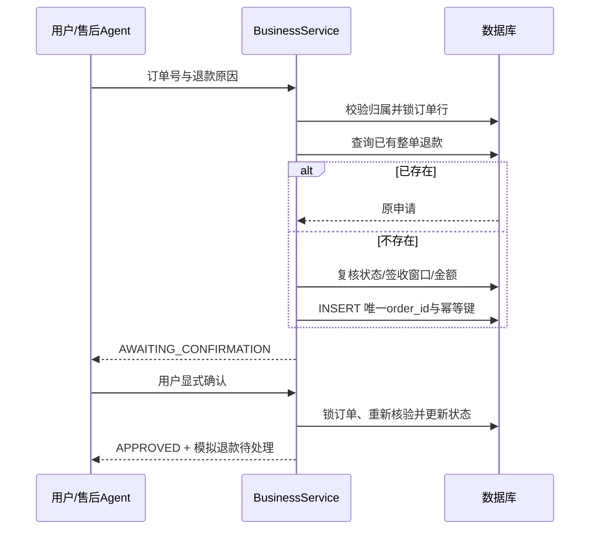

# 数据设计与生命周期

## 存储分工

关系数据库保存商品、订单、退款、会话、消息、服务单、运行和检查点；pgvector 保存同一数据库中的向量列。Redis 是可以丢失的查询缓存，RabbitMQ 是任务唤醒通道，持久 agent_run 才是任务来源。图片和 Markdown 在 `data/images/`、`data/knowledge/`，Git 保存原创素材，不保存运行数据库。

## 表结构

| 表                | 主要字段                                                        | 约束与用途                               |
| ----------------- | --------------------------------------------------------------- | ---------------------------------------- |
| product           | id、owner_id、payload、version                                  | 商品目录；payload 为产品扩展属性         |
| customer_order    | id、owner_id、payload、version                                  | 所有权索引；行锁与版本号支撑售后修改     |
| conversation      | id、owner_id、payload、version                                  | 客户所有权；串行创建同会话任务           |
| chat_message      | id、owner_id、conversation_id、payload、created_at              | 会话与时间索引，user/assistant/human角色 |
| agent_run         | id、owner_id、conversation_id、status、payload、时间戳          | durable任务来源、条件认领、租约恢复      |
| run_event         | identity id、run_id、event_type、payload、created_at            | 有序事件，SSE cursor补发                 |
| graph_checkpoint  | thread_id、checkpoint_id、payload、created_at                   | 联合主键；当前节点和下一节点             |
| escalation_ticket | id、owner_id、conversation_id、status、payload、version         | 归属、工作状态、乐观锁                   |
| refund_request    | id、owner_id、order_id、idempotency_key、amount、status、reason | order_id唯一、幂等键唯一、NUMERIC金额    |
| knowledge_chunk   | id、source、heading、content、hash、vector_text、embedding      | 内容版本、引用、pgvector512维向量        |

为了保持课程项目的可读性，商品、订单、服务单扩展字段采用 JSON 文本，关键索引、所有权、退款金额和工作状态有独立列。没有把这描述成完整财务域的生产级规范化模型；正式业务需要逐步规范化订单明细、货币、支付流水、退款批次、审计表与外键，并采用 Flyway/Liquibase 迁移。

## 退款幂等的正确顺序

幂等键为 `SHA256(userId|orderId|FULL_REFUND_V1)`。原因文字不能作为退款次数的分割依据，换一个原因也不能绕过整单退款限制。归属核验先于返回旧记录，避免通过幂等查询读取他人的数据。数据库唯一约束是最后防线，应用层行锁使并发请求获得同一结果。

金额始终取订单记录，用 BigDecimal 与 NUMERIC(12,2)，没有来自模型或前端的金额入参。真实支付需新增支付请求幂等键、外部结果查询、回调验签、金额守恒、支付状态机和 reconciliation；本版没有模拟一笔“真实到账”。

## 状态与乐观锁

服务单更新使用 `UPDATE ... WHERE id=? AND version=?`，每次版本+1；不匹配返回409。处理结论写回原会话和服务单更新在同一事务中，避免完成状态存在而客户没有回复。

Run 创建使用客户端 requestKey，服务端结合用户与会话哈希为 run_id。同键重复输入返回原任务；同键不同问题拒绝。消费者条件认领，一次任务可有多个消息唤醒但最多一个活跃执行者。运行租约与恢复限制见可靠性文档。

## 文件与向量生命周期

源文档按标题定位片段并保存内容哈希。重建索引更新已变片段、清除已消失片段、变更整体修订号。引用输出保留当次内容，使历史回答不会因为源文档后来改变而失去当时的依据。

图片目录通过只读静态资源映射公开；没有把整个 data 目录映射给浏览器，避免文档源、运行文件或其他数据被任意下载。Docker 中文档和图片只读挂载；可写运行数据在数据库具名卷。

## 保留、备份与删除

演示默认保留历史，没有自动清理客户会话。正式环境应制定业务、隐私与成本要求，例如保留工单审计、限制追踪期限、允许用户删除非强制保留的对话。当前没有提供“已实现合规删除”的声明。

PostgreSQL 使用逻辑备份并验证恢复；Redis 缓存无需进入关键恢复链；RabbitMQ恢复后数据库的QUEUED任务会再次派发。Docker down保留数据，down -v删除卷；本地H2停止Java后再复制文件备份，运行中直接复制可能不一致。
