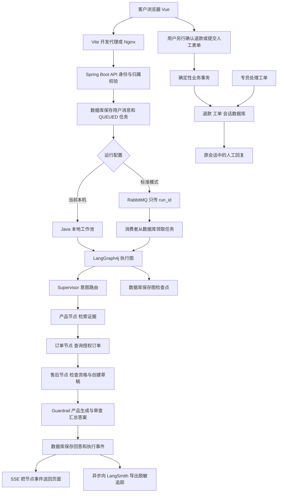

# SmartServe 项目学习手册与上线路线

核对日期：2026年10月14日。核对代码版本：本机 HEAD d27e4c4。

这份手册帮助你从一条用户服务流程理解现有实现，并规划后续演进。它结合你的 Python LangChain 与 LangGraph 学习材料解释概念，但以本项目 Java 代码的实际行为为准。文档中的优化项是后续计划，不代表已经完成。这次只新增本手册，没有改动项目业务代码、配置、原有文档，也没有提交或上传 GitHub。

## 1 先确定你现在运行的是什么

SmartServe 当前是一个智能家居客服与售后工程原型。商城展示商品，客服解释产品、查询样例订单、创建待确认退款草稿，用户可以提交人工服务单，专员处理后把结果写回会话。商品、订单、物流和资金处理均包含演示数据或模拟行为，尚未形成完整的真实交易平台。

你本机 `.env` 当前选择 `SPRING_PROFILES_ACTIVE=postgres-local`。这个模式用你系统安装的 PostgreSQL 保存数据，中文 BGE 模型在 Java 进程中计算向量，Java 在内存中比较余弦相似度，Agent 任务交给本地工作线程。它不使用 Redis 检索缓存，也不通过 RabbitMQ 派发任务。

| 运行模式 | 业务与会话数据 | 向量检索执行位置 | Agent 任务派发 | Redis 检索缓存 |
|---|---|---|---|---|
| demo | H2 文件数据库 | Java 内存中的余弦比较 | 本地工作池 | 未启用 |
| postgres-local，当前本机 | 系统安装的 PostgreSQL | Java 内存中的余弦比较 | 本地工作池 | 未启用 |
| postgres，默认标准配置 | PostgreSQL | pgvector 扩展，HNSW 索引 | RabbitMQ | 启用 |

因此，“代码中写了 Redis、MQ、pgvector”和“当前这次运行真的连接这些组件”是两件事。当前本机模式是真实数据库持久化与真实中文向量检索，但没有使用 pgvector 执行搜索。标准配置与对应组件集成测试已经存在；历史验证记录见原有 `docs/evaluation.md`。此次没有重新执行运行测试或全套 Docker 部署。

## 2 用一条连续的服务流程理解全部核心组件

我们选择下面这个场景：客户已有一笔 S1 门锁订单，先询问断网能不能开门、查询订单并申请退货，核对后确认申请，随后要求人工专员核验安装和寄回事项，专员完成服务单，客户收到回复，运营查看整条 Agent 执行记录。

这里使用已有样例订单，项目目前没有真实购物下单和支付接口。说明退款分支时假设订单已签收三天且仍满足样例资格规则。实际演示要查看数据库中的签收日期：样例日期只在第一次初始化时生成，重启不会每天刷新为“签收三天”。自动退款还要求当前订单状态为 DELIVERED，已经确认过的订单也不能按新申请再次演示。

这条业务旅程需要多轮交互。人工升级是单独分支，当前图中 ESCALATE 会优先覆盖其他路径，不能把所有节点硬塞进一句话后声称它们全部执行。



上图产品→订单→售后的路径用于同时命中三个意图的情况；仅咨询产品时可以直接到 Guardrail，仅问订单时直接执行订单节点。人工请求另走 Supervisor→Escalation→Guardrail。

## 3 回答问题之前 知识库先完成准备

你的 RAG 学习材料把流程分为离线建库和在线问答。项目也有这两阶段。“离线”是提前准备知识，不表示服务器断网。

第一步，后端启动后从 `data/knowledge` 读取 Markdown 文件，目前是产品手册、售后政策、FAQ。代码没有 Word、PDF 上传解析、OCR 或外部网页采集管线。你这次提供的课程文档用于讲解，没有被加入客服知识库。

第二步，按 Markdown 二级标题 `##` 切章节。章节内容太长时再按最多500字符切分，每次向后移动450字符，通常保留50字符重叠。标题与正文一起送给向量模型。这样能保留“这是S1联网与保修”这样的主题线索，同时控制片段长度。它是结构切分加固定字符窗口，不是递归句子切分，也不是按 Token 精确限制。

第三步，计算片段标识和内容哈希。标识由来源文件、章节标题和起始位置生成，内容哈希用于判断正文是否改变。已保存的内容和向量未变就复用，改变的重新向量化，移除的片段删除。这能减少每次启动的重复计算，但现在没有完整的知识发布、审批、回滚和版本并存流程。

第四步，用 LangChain4j 的 `BgeSmallZhEmbeddingModel` 把每段文字转换为512维向量。可以把它理解成512个数字组成的“语义坐标”。相似的表达通常位于比较接近的位置。BGE 在本地通过 ONNX 运行；DeepSeek负责聊天和判断，两者分工不同。DeepSeek聊天 Key 不会自动让这里获得 Embedding 服务。

第五步，保存到 `knowledge_chunk`。表中包括来源、标题、正文、内容哈希和向量文本。在标准 pgvector 模式还会建立 `vector(512)` 列和 HNSW 余弦索引。当前本机没有启用该扩展，因此向量保存在 PostgreSQL，启动时也加载到 Java 内存，检索计算在 Java 中完成。

历史实际建库结果为3份文档、40个片段。换模型后不能直接混用旧向量：问题和片段必须使用相同的模型和对应版本，必要时重建索引。目前缓存和重建判断尚未完整纳入模型版本，这是后续要补的地方。

## 4 客户点击发送 请求如何进入系统

客户可以先通过商品目录接口查看商品、通过图片接口加载展示图片。Vue负责页面和交互，Element Plus提供表单、弹窗和表格等界面组件，图片是展示资源，不参与当前文本RAG。

进入客服后，前端创建或选择会话。发送问题时调用 `POST /api/runs`，业务内容主要为：

```json
{
  "conversationId": "conv-示意编号",
  "question": "S1门锁断网还能开门吗？查一下我的订单SS20261010001，我想申请退货。",
  "requestKey": "本次请求的唯一键"
}
```

身份来自请求的 Bearer 凭证，由服务端解析成 Actor。客户端不能靠在正文填一个 userId 就把订单查询变成别人名下的查询。当前凭证来源仍是演示接口，真实登录问题在后文单独说明。

开发模式下，浏览器访问5173，Vite把 `/api` 转发给8080上的Spring Boot。Docker前端则由Nginx提供编译后的网页并转发接口。

API先校验身份、会话归属和参数长度，再在事务中锁定会话，检查本会话是否仍有 QUEUED 或 RUNNING 任务。若已有任务未完成，返回冲突；同一 requestKey 对应相同问题会复用旧任务，对应不同问题会拒绝。

随后在数据库保存三类内容：`agent_run` 中的QUEUED任务、`chat_message` 中的用户消息、`run_event` 中的排队事件。事务返回并提交之后，控制器才调用派发器。这让任务内容先落地，再发送唤醒消息。页面很快拿到 runId，后续通过SSE接收进度，Agent不在最初的HTTP请求里一路同步执行到底。

这里有三个ID要分清：userId识别用户，conversationId识别会话，runId识别本轮任务。一个会话可以有多轮任务，每轮有自己的执行记录和检查点。

## 5 MQ在哪里用 放进去的到底是什么

当前项目选用的MQ是RabbitMQ。MQ可以理解成取号后排队的通知系统，生产者放消息，消费者按自己的处理能力领取。

标准配置下，派发器向持久队列 `smartserve.runs` 发送一个字符串，例如：

```text
run-示意任务编号
```

队列消息没有装完整聊天记录、数据库密码、模型 Key 或最终回答。任务的问题、身份快照、会话ID和状态已经在数据库中。消费者拿到编号，再去数据库读任务。

消费者首先执行带条件的更新：只有状态仍为QUEUED的任务可以变成RUNNING。更新影响一行才表示领取成功；重复消息发现任务已领取或已完成就返回。这是防止重复唤醒立即执行两遍的基本措施。

然后消费者调用图编排器，读取会话和检查点，执行Agent节点，最终把任务标记为COMPLETED或FAILED。Rabbit消费者并发配置为2到4；当前本机替代路径是4个线程、64个等待位置的有限工作池。

为什么需要MQ？模型调用可能比较慢，接收用户请求的接口和实际处理任务可以各自扩容；突发请求先排队，消费者按能力处理。但排队只是把等待移了位置，不能让外部模型接口自动变快，也不能证明系统已经承受大规模并发。

目前另有每5秒扫描数据库的恢复机制：重新派发QUEUED任务；把超过180秒没有更新时间的RUNNING任务重新排队，再尝试从检查点恢复。这是数据库任务表加补偿扫描的机制，尚不是具备发布确认、独立Outbox投递状态和租约隔离的完整方案。

还声明了 `smartserve.runs.dlq` 死信队列。但执行异常目前主要被捕获后写成FAILED，不能声称所有Agent失败都会自动进入死信队列。失败分类、重试次数、死信处理和人工重放都需要后续完善。

当前MQ用途清单只有Agent任务派发及对应的死信队列配置。退款确认、工单提交、人工处理结果回写走HTTP业务接口和数据库事务；还没有订单支付、库存释放、物流回调、短信通知等消息队列流程。

## 6 LangGraph4j怎样安排这张工作单

用你课程里的State、Node、Edge理解：State是这轮任务的工作单，Node是处理工作单的工位，Edge是工位之间的流向，Graph是整条处理路线。

当前State中放了runId、userId、admin、question、context、searchQuery、routes、tokens，以及后续产生的productAnswer、orderAnswer、afterAnswer、证据和业务卡片。身份由后端注入，不让模型自行确定。

Supervisor先用规则识别意图。如果命中人工或明确设备危险关键词，直接走ESCALATE；其他情况开启模型时调用DeepSeek生成受限的routes JSON。只有PRODUCT、ORDER、AFTER_SALES、ESCALATE这些值会被接受，失败回退到规则。

如果三种普通意图都命中，按照产品→订单→售后顺序执行，然后到Guardrail。它们在同一轮内不是并行执行；本地4线程或Rabbit多消费者表示多轮任务之间可以并发，不表示本轮三个专家同时运行。

LangGraph4j真正负责的是注册节点、固定边和条件边、状态更新、执行图以及调用原生检查点接口。项目用自定义 `JdbcCheckpointSaver` 将框架检查点保存到 `graph_checkpoint`，内容包括状态、当前节点和下一节点。

检查点的threadId目前等于runId，不等于conversationId。这是每轮执行恢复的标识；长期聊天历史另存在chat_message。恢复时找到该runId最近的检查点，再调用图继续执行。

它能帮助恢复图状态，但不自动保证外部副作用恰好执行一次。数据库业务写入之后、图检查点保存之前若进程崩溃，恢复时节点仍可能再执行，所以退款等写工具必须独立幂等。多Worker下还要补租约所有者、心跳和fencing，防止旧Worker超时后恢复继续写入。

## 7 MCP怎样把Agent接到业务工具

课程把MCP比作统一接口，这个理解适用。协议规定如何发现工具和调用工具；工具内部仍需要真实的业务代码。

在当前项目中，Agent系统相当于Host，`McpBridge`是Client，`/api/mcp`和`ToolRegistry`构成Server。Client和Server暂时在同一后端应用里，通过真实HTTP通信，尚未拆成多个独立团队的远程服务。

某个领域首次调用时，先发送initialize，通知初始化完成，再调用tools/list，取得该领域允许的工具名称。目录缓存在Java进程中。之后使用tools/call发送工具名和业务参数，服务器返回JSON结果。

例如产品领域发送searchKnowledge和query；订单领域发送queryOrderStatus和orderId；售后领域发送checkRefundEligibility或createRefundDraft。身份和领域权限通过可信服务请求信息带给服务端，服务端再次校验领域白名单与数据归属。

| 领域 | 可以调用的工具 | 关键限制 |
|---|---|---|
| PRODUCT | searchKnowledge、getProducts | 无权创建退款 |
| ORDER | queryOrderStatus | 查询仍校验订单归属 |
| AFTER_SALES | searchKnowledge、queryOrderStatus、checkRefundEligibility、createRefundDraft | 无确认退款和转账工具 |

当前节点具体调用哪个工具，主要由Java逻辑控制，并不是模型不断返回function calling再自动循环。LangChain4j的 `@Tool` 标注出现在部分工具方法上，但本项目没有因此自动获得AiServices的完整工具循环；MCP工具定义和调用分发主要是手写实现。

MCP工具HTTP和浏览器SSE进度是不同用途的两条通信。Streamable HTTP可以返回普通JSON，也可以使用SSE；不能把它直接等同于“每次工具调用都用SSE流式返回”。本项目主要采用JSON应答的最小协议实现，未完成广泛服务互通、OAuth、完整能力协商与一致性验证。

同应用中直接调用BusinessService也能完成业务。当前MCP层的价值是明确工具合同、发现过程和权限边界，并提供后续拆服务的接口；代价是多一层协议代码、HTTP开销和维护负担。

## 8 RAG在线检索 具体怎么找出那几段资料

产品节点通过MCP调用searchKnowledge。下面每一步都对应当前KnowledgeService中的实际逻辑。

### 8.1 先得到检索问题

普通问题直接作为searchQuery。对于少于25字符、带“它、这个、还”等代词且没有明确产品、订单或退款关键词的追问，代码尝试拼接上一条用户问题。词法阶段还把联网替换为网络、退钱替换为退款、没电替换为供电等。

这些是简单上下文拼接和同义词规则，尚不是课程中的LLM Query Rewrite、Multi-Query、HyDE或多跳问题拆分。Supervisor的业务分类也不等于把复杂知识问题拆成多次检索。

### 8.2 标准模式先看Redis

缓存键由知识库revision、检索策略、问题哈希和返回数量组成。缓存值是完整的候选片段JSON，包括正文、来源、标题和分数。TTL为15分钟。

命中时直接返回结果，跳过本次BGE向量化和召回计算。没有命中才计算，并将结果写入Redis。知识改变后revision改变，自然使用新键。Redis连接失败会回退检索，主要影响耗时。

当前代码只在async-mode等于rabbit时读写这一缓存，缓存开关和队列模式耦合在一起。postgres-local模式不访问它。Redis没有承担会话长期记忆、检查点、分布式锁、库存或登录会话职责；也没有用Redis向量检索模块。

### 8.3 向量召回 看语义

用同一个BGE中文模型把问题转换为512维向量。标准模式让pgvector按余弦距离搜索Top20；HNSW是数据库为向量搜索建立的近似索引。当前本机模式遍历内存中的片段向量，计算余弦相似度，再排序。

例如“家里网络断了还能开锁吗”和文档中“断网时本地指纹、密码、机械钥匙可用”不必每个字相同，也可能语义接近。

### 8.4 词法召回 看关键词

中文主要拆成相邻两个字符的组合，也提取英文与数字词，再根据关键词在多少片段出现和片段长度等因素计算BM25式得分。它对S1、5GHz、NFC这样的型号或具体能力很有帮助。

当前是Java里自行实现的简化词法评分，使用词项集合，未完整保留词频；也没有Elasticsearch或专业中文倒排索引。规模较小时易理解，大规模下需要更成熟的实现和性能优化。

### 8.5 融合与排序

设计意图是合并向量与词法各自靠前的候选，再结合语义、归一化词法分数和RRF排名信号排序。当前混合分数权重是0.72、0.23、0.05，RRF信号还有尺度调整。RRF可以理解为“多个榜单都排得靠前，就多得一些分”。

需要补充一个此次代码核对发现的错误：标准模式下，没有进入向量Top20列表的片段，indexOf返回-1。当前候选判断将-1当成小于20，RRF也为该不存在的排名加分。后续应对未入榜的结果贡献0分，并只合并真实召回项。这里描述的是设计流程，当前实现尚有这个边界问题待修正。

当前重排是分数加权和排名融合，没有运行Cross-Encoder或神经reranker，也没有MMR。课程里的Cross-Encoder是把问题和候选片段一起送入另一个模型精排，应该作为有评估数据后的实验选项。

### 8.6 门槛与证据

searchKnowledge通常返回最多4个候选。产品节点筛选accepted=true的片段，再取最多3条作为证据。开启Embedding时，当前接受条件包括命中业务领域规则、semanticScore至少0.63、归一化lexicalScore大于0.08。

这些阈值是当前小语料上的规则门槛，不是“回答正确概率达到63%”。领域规则也只是关键词规则，不能等同于完整的开放域识别或提示注入防护。

候选带有S1、S2等引用编号、来源和章节。产品证据为空就说明无法确认，并提示补充信息或提交人工服务单；不会直接凭模型记忆补产品规格。

### 8.7 生成和审查实际在Guardrail

产品节点先收集证据并准备原文摘录。到Guardrail后，才让DeepSeek根据用户问题和证据生成产品回答。系统提示要求资料中夹带的指令只视为资料，每项事实使用提供的引用。

代码检查引用是否存在于证据白名单、是否至少包含一个合法引用，然后发起第二次模型调用，让独立的审查提示判断所有实质事实是否被证据支持。通过才使用生成答案；引用错误、审查不通过或模型调用失败，会保留原文摘录。

两次调用通常仍使用同一个模型，只是提示和职责分开，不能称为异构模型交叉验证。引用编号合法也不代表每个陈述都与引用内容一致，模型审查可能漏判，这些都需要评估集和人工抽检验证。

若模型路由、产品生成和审查都成功，一轮产品咨询通常涉及三次模型调用；订单与退款规则处理本身不依赖模型猜测。开启模型时并非所有节点都会各自调用一次模型。

## 9 订单和退款 如何把AI建议变成可信业务

订单节点调用queryOrderStatus，业务层先确认订单属于当前客户，再读customer_order，返回状态、商品、物流和运单信息。它查询的是数据库事实，不拿订单号去知识库找物流，也没有当前接入真实物流平台。

售后节点先检索退货政策，再调用checkRefundEligibility。当前自动资格只确定性检查已签收状态以及签收日期到今天相差0到7个日历日。文案会提醒包装、安装和质检要求，但系统尚未真正验证这些条件，因此不能把日期通过称为全部售后条件审核通过。

当前一个重要缺口是：AFTER_SALES包含退款、保修、维修和换货等意图，而节点拿到满足日期资格的订单后，会继续调用createRefundDraft。仅仅问“怎么保修”也可能被带入退款草稿路径。后续必须细分咨询、维修、换货、退货申请等动作，并在写操作前明确用户申请意图。

对于明确申请退货的正确路径，createRefundDraft做以下工作：先校验订单归属；在事务里锁订单；检查已有退款；从数据库订单取金额；用订单所有者、订单ID和整单退款类型生成幂等键；建立AWAITING_CONFIRMATION记录。数据库对order_id和idempotency_key都有唯一约束。

这时只是草稿，用户没有确认，订单状态还不变化。重复调用或换一种退款理由，仍会得到同一笔整单退款申请。幂等保护依靠业务键、事务、行锁和数据库约束，不依赖Redis锁。

用户看到卡片，核对后点击确认。浏览器另行调用 `/api/refunds/{id}/confirm`，服务端重新验证归属、确认值、订单最新状态和资格，再把退款改为APPROVED、订单改为REFUND_PENDING。重复确认会返回已有结果。

确认接口不在Agent工具白名单里。因此AI不能自己调用它完成确认；这一步走普通业务接口和数据库事务，不再进入MQ。但它仍然是模拟处理，没有真实转账，也没有完整的寄回、收货、质检、部分退款和支付对账流程。

## 10 人工处理 如何结束这条服务旅程

客户后续说“请人工专员帮我核验安装和寄回事项”，新一轮任务通过相同的API和派发路径进入图。Supervisor走ESCALATE，Escalation节点准备人工表单提示，Guardrail结束本轮。

Agent只是建议和准备移交，尚未自动创建工单。用户填写标题、详情、联系方式、可选订单，确认后调用POST /api/tickets。服务端校验归属与确认，在数据库保存PENDING工单，关联原conversationId，并写一条提交成功消息。

工单带有requestKey，重复提交同一键会复用旧记录。当前“摘要”是拼接用户历史问题，不是经过模型压缩、人工审核的专业移交摘要。

专员进入处理中心，看到工单及会话，先把PENDING改为PROCESSING，填写内部备注和处理结果，再改为RESOLVED。更新带version，过期版本返回冲突，防止两个编辑者把对方修改直接覆盖。状态也不能从待处理直接跳到已完成。

完成时，事务把human角色回复写回原客户会话。客户读取消息就能看到人工结果；客户接口过滤内部notes和summary。当前不是实时坐席聊天，也没有完整的分配权限、SLA、超时提醒、通知和重开机制。更新中的assignee记录当前操作者，尚未严格限制只能由已分配专员处理。

这里体现了人参与决策的业务设计，但没有调用课程的interrupt和Command(resume)让同一Agent图暂停后恢复。当前Agent任务结束后，由业务工单状态机接续人工工作。

## 11 回答怎样回到页面 AgentOps怎样记录

每个关键步骤会写run_event：排队、路由、MCP调用、检索候选、审查、完成或失败。事件有递增ID，也可能包括耗时、候选分数、工具输入和Token统计。原始问题与完整业务记录保存在本地数据库，必须受访问控制和保留策略保护。

浏览器连接 `/api/runs/{id}/stream`。当前后端每250毫秒读该任务新事件，通过SSE推送。前端携带Last-Event-ID重连，按事件ID去重，完成后再读取最终任务与会话消息。当前有64条SSE连接上限，连接超时240秒。

SSE像一条持续打开的进度通知通道，用于把“已路由”“检索完成”“回答完成”等状态送到页面。它不是任务队列，也不是数据库。当前展示的是节点进度加最终完整答案，没有真正逐Token转发模型输出，也没有展示模型隐藏思维链。

AgentOps页面是项目自己写的运营与追踪页面。它读取数据库中的真实运行记录，展示完成次数、延迟、Token合计和事件时间线。监控记录能帮助找到错误发生在哪个环节，不能单凭有记录就判断答案质量。

开启LangSmith后，TraceExporter在独立线程中读取这一轮任务和事件，用REST API向LangSmith发送一条根run和多条子run，建立父子关系。对外只发送问题长度、用户哈希、路由、状态、耗时和Token等元数据，不发送原始聊天全文、联系方式或工具原始结果。

这意味着本地AgentOps加LangSmith追踪已接入，并没有接同名第三方AgentOps SDK，也没有已经实现完整的OpenTelemetry、告警平台或自动幻觉检测产品。LangSmith关闭或网络失败时，主业务仍能完成，本地记录保留。当前导出队列有限且可能丢弃，可靠重试、导出失败指标和准确的模型调用Span仍需补充。

注意“远程追踪脱敏”不等于“发给DeepSeek的所有消息都脱敏”。后者还需要独立的模型输入和工具输出最小化、PII检测与处理措施。

## 12 把Java实现对应到你的课程概念

LangChain4j和Python LangChain是不同项目，LangGraph4j和Python LangGraph也是不同项目。概念可以迁移，API和默认能力不能直接照搬。本项目锁定LangChain4j 0.36.2、LangGraph4j 1.8.20；这只是当前代码组合，不代表最新版本。

| 课程概念 | 本项目实际对应 | 目前边界 |
|---|---|---|
| Model | ModelGateway中的OpenAiChatModel，连接DeepSeek兼容接口 | 单模型；45秒超时、有限重试、4个并发许可 |
| Embeddings | BgeSmallZhEmbeddingModel | 本地中文ONNX，512维 |
| Document Loader | KnowledgeService读取Markdown | 未接通用Word/PDF/OCR加载器 |
| Text Splitter | 二级标题加500字符窗口 | 手写切分，未接递归切分组件 |
| Vector Store | PostgreSQL表、pgvector SQL或JVM余弦 | 未直接使用完整的框架EmbeddingStore检索管线 |
| State | AgentOrchestrator.State及字段更新 | 本轮共享Map，尚未使用严格的领域输入投影 |
| Node和Edge | LangGraph4j节点、固定边、条件边 | 领域顺序执行，没有动态Send并行派发 |
| Checkpointer | JdbcCheckpointSaver和graph_checkpoint | 按runId恢复执行，与会话历史分开 |
| Tool | ToolRegistry和领域白名单 | 当前多为程序控制调用，没有每域自主ReAct循环 |
| Runtime Context | 后端Actor、身份注入、Spring依赖 | 概念对应，未使用Python ToolRuntime对象 |
| Store长期记忆 | 尚未建立明确的用户偏好与记忆模块 | 业务数据长期保存不等于Agent长期记忆 |
| Middleware | ModelGateway、权限检查、Guardrail、日志和降级逻辑 | 分布在多处，未采用Python before_model/wrap_tool_call钩子 |
| HITL | 退款用户确认与人工工单 | 业务状态机实现，未采用Graph原生interrupt/resume |
| Multi Agent | Supervisor路由加受控领域节点 | 接近Router和串行领域协作，没有独立模型自由群聊 |

LangChain4j负责当前模型和Embedding的Java接口；LangGraph4j负责流程图。它们不会替你自动实现权限、退款幂等、缓存失效、队列一致性或正确的业务规则，这些由应用代码承担。

记忆也应拆开理解：数据库chat_message是完整聊天存档；最近9条消息、最多6000字符是本轮送入处理逻辑的短期上下文；graph_checkpoint是执行恢复快照；将来的用户偏好Store是跨会话可复用记忆；Redis现在是可丢弃的检索缓存。

因此，保存历史不等于每次把全部历史发给模型，有限窗口截取也不等于语义摘要压缩。目前各节点工具权限确实分域，但图State仍共享，不能宣称每个Agent都拥有完全隔离的上下文和独立ChatMemory。

当前RAG更接近“路由后执行受控检索与生成，再做证据审查”的架构。产品分支内部有2-Step流程，外围加入路由和验证。这里的Hybrid RAG架构与Hybrid Retrieval算法是不同概念：前者描述整个问答流程，后者描述向量和词法两路搜索。

## 13 Docker 从刚安装Desktop开始理解

Docker Desktop提供管理和运行容器的环境。打开Desktop本身不表示已经启动SmartServe。命令行docker是客户端，还需要Docker引擎可用；此次只读检查发现客户端已安装，但当前命令未连上Linux引擎，不能由此推断你已经创建的Redis容器不存在。

镜像可以理解成装配好的软件模板，例如一个包含PostgreSQL和pgvector的模板。容器是用模板启动的运行实例。Dockerfile说明怎样制作镜像，Compose描述多个容器、网络、端口、配置和数据卷如何组成一套项目。

本项目有两个自制镜像：后端构建阶段用Maven与JDK21编译，最终镜像保留JRE21和可运行JAR；前端构建阶段用Node安装依赖并编译，最终镜像由Nginx提供dist静态文件。Redis、RabbitMQ和带pgvector的PostgreSQL使用已有镜像。

完整部署是五个容器：frontend、backend、postgres、redis、rabbitmq，各自是独立运行组件。没有把它们全部塞进一个容器。前端部署时也不需要继续运行Vite开发服务器。

数据库、Redis和Rabbit有各自命名数据卷。容器是可以更新替换的运行实例，数据卷负责保存状态。普通down不会自动删这些命名卷；带-v的down会删除卷，因此不应当成日常停止命令。系统安装的PostgreSQL和其数据目录属于另一套实例。

在项目根目录：

```powershell
docker compose up -d
```

按当前Compose定义，只启动postgres、redis、rabbitmq三个基础设施服务。前后端都标记了app profile，未启用该profile时不启动。

```powershell
docker compose --profile app up -d --build
```

这才构建并启动完整五个服务。--profile app选择应用服务，up创建或启动，-d在后台运行，--build要求构建应用镜像。第一次需要网络下载基础镜像与依赖。

### 13.1 你已有的PostgreSQL和Redis会不会自动加入

不会。你的本机PostgreSQL、你单独创建的Redis容器，以及本项目Compose里的postgres和redis服务，是不同实例。Compose没有自动把前两者收编进来。

当前Compose准备占用宿主机5432、6379、5672、15672、8080和5173。如果本机PostgreSQL正用5432，或者已有Redis正用6379，就可能端口冲突；一键脚本运行的前后端也会占用8080和5173。

可让Compose的数据库映射为127.0.0.1:15432:5432、Redis映射为127.0.0.1:16379:6379，保留原来的服务。冒号左侧是宿主访问端口，右侧是容器内部端口。这个手册只是说明选择，没有替你修改Compose。

容器内后端用postgres:5432、redis:6379、rabbitmq:5672访问同一Compose网络中的服务，名字由容器网络解析。容器内localhost指当前容器本身，不指你的Windows电脑。手动运行在Windows上的Java访问映射的数据库时，则用localhost:15432。

你提到的Redis账户dev也不会自动被项目使用。当前Spring配置只显式配置Redis密码，没有dev用户名；Compose创建的Redis用requirepass形式的默认用户。若已有Redis确实是ACL用户dev，后续需要配置用户名、密码、地址和权限才能复用。Docker Desktop账户与Redis自身账户也不是一回事。

目前先继续用postgres-local学习最省事，等理解流程后再选择复用现有组件或启动独立标准栈。Docker的实际用途是减少手工安装与版本差异，让别人可以按相近环境复现项目；数据库真实连接、外部模型访问、授权规则和数据备份仍要正确配置。

## 14 一键PowerShell脚本 逐步做了什么

```powershell
cd E:\SmartServe
powershell -ExecutionPolicy Bypass -File scripts/start.ps1
```

cd切换当前终端到项目目录。powershell启动一次PowerShell执行过程。-File指定运行脚本。-ExecutionPolicy Bypass让这一执行过程允许运行该脚本，不是安装依赖的命令，也不是永久关闭系统所有脚本限制。

start.ps1依次创建.local日志目录、在.env缺失时复制示例配置、检查8080与5173端口、选择Maven、构建后端JAR、在node_modules不存在时运行npm ci、后台启动java -jar和Vite两个进程、保存PID与日志位置。

Maven下载的是Spring Boot、LangChain4j、LangGraph4j、JDBC驱动、ONNX/BGE模型等后端依赖，缓存到本地仓库，再把应用打成可运行JAR。npm ci按package-lock.json安装Vue、Element Plus、Vite等前端包到node_modules。脚本不负责安装Java、Node、PostgreSQL、Redis或RabbitMQ软件，也不运行Docker。

SQL初始化由Spring Boot启动时执行schema.sql来创建不存在的表，再由SeedData初始化样例数据。知识建库由KnowledgeService启动逻辑完成。数据库服务及smartserve数据库本身必须先存在并能连接；此前本机专用库已经创建。脚本不会创建一个Redis实例或MQ服务。

前后端确实各自运行，只是脚本替你启动两次。前端进程监听5173，后端进程监听8080，PostgreSQL作为外部服务通常早就运行了。一个命令表示统一操作入口，不表示只有一个进程。

已构建且Java代码未改动时可用-SkipBuild；-Offline关闭付费模型调用及LangSmith导出，仍保留本地Embedding、检索和业务处理，它不保证第一次构建或依赖下载时完全不联网。

停止这两个后台进程：

```powershell
cd E:\SmartServe
powershell -ExecutionPolicy Bypass -File scripts/stop.ps1
```

stop脚本根据保存的PID和命令行中的项目路径确认所属进程，不停止本机数据库，也不停止Docker容器。浏览器关掉同样不等于后端进程关闭。

### 14.1 想看见前后端两个终端怎样手动运行

先停止脚本已启动的前后端，避免端口冲突。后端终端：

```powershell
cd E:\SmartServe\backend
& 'E:\develop\software\apache-maven-3.9.6\bin\mvn.cmd' -B -ntp -s '..\.local\maven-settings.xml' '-Dmaven.repo.local=..\.local\m2' package -DskipTests
java -jar target\smartserve-backend-1.0.0.jar
```

这里的Maven路径、settings和缓存路径对应当前电脑已有文件；另一台电脑应使用其实际Maven和仓库配置。不要不加核对地复制机器专属路径。

前端另一个终端：

```powershell
cd E:\SmartServe\frontend
npm ci
npm run dev
```

已有依赖且lock文件未改变时可以直接npm run dev。浏览器访问http://localhost:5173。前端源码变化由Vite热更新；后端源码变化后，旧JAR不会自己更新，需要重新编译并重启Java。

想断点学习，可在IDEA打开backend/pom.xml，运行SmartServeApplication，Working directory设为E:\SmartServe\backend；前端继续独立启动。适合观察的入口是ApiController.createRun、RunDispatcher.consume、AgentOrchestrator各节点和BusinessService.createRefund。

## 15 当前做到了什么 怎样判断Agent有没有变好

你的评估材料区分“搜对了吗”和“回答对了吗”，这两层必须分开。

检索层可以看Recall@K、MRR、关键词与型号覆盖、无关问题误接受率、耗时和缓存命中率。项目历史真实小样例结果如下：

| 策略 | Recall@5 | MRR@5 | 无关问题误接受 |
|---|---:|---:|---:|
| vector | 0.8529 | 0.9118 | 0/3 |
| BM25式词法 | 0.9706 | 0.7078 | 0/3 |
| hybrid | 0.9706 | 0.8186 | 0/3 |

样例只有17个正例和3个负例，并使用同一小集合开发调参，没有独立保留测试集。这只能说明当前样例上混合检索覆盖更多标签，纯向量首个相关片段排名更好，不能说Hybrid各项指标全部优于Vector，也不能说0/3代表没有无关问题误接受风险。

生成层再评估Faithfulness、回答正确性与相关性、引用覆盖、噪声敏感性、拒答合理性。在线独立证据审查是一种运行时门控；离线RAGAS是批量实验，两者不相同。

项目提供可选RAGAS脚本，但尚未完成其模型评估，没有可宣称的RAGAS成绩。课程与项目锁定的RAGAS版本和API不同，不能直接把课程的字段名与最新安装命令复制进去，尤其不应把修改第三方包空壳当成长期兼容方案。

Agent整体还要评估意图路由、多意图任务完成、工具参数正确性、越权阻断、写操作确认、同一业务重复调用、服务故障与恢复效果。高Faithfulness不保证用户请求被完整完成，工具调用正确也不代表真实业务已经成功。

## 16 上线路线 按依赖顺序推进

建议正式产品先定位为“连接已有订单系统的智能客服与售后工作台”。这让业务边界清晰：解释产品，查授权订单，创建明确授权的售后申请，人工接续，追踪全过程。若将来要运营真正的商城，再另行补齐交易系统；不必为了让客服项目显得完整就立刻重建购物车、支付和仓储。

### 第一阶段 先修正理解和当前正确性问题

细分售后意图，明确咨询不会写退款；修复未入榜候选的RRF处理；把最终答案各部分和各自来源关联，避免产品证据与政策证据混在一起或后者被覆盖；确保路由优先判断当前问题，历史仅用于必要的指代补全。

准备可重复业务样例与时间控制，不通过反复清空数据库刷新退款资格。建立空知识库、旧政策、型号混淆、断网追问、仅保修咨询和多意图的回归用例。

验收应能展示：问保修没有新增退款记录；未召回片段没有该路RRF贡献；每项回答能追到对应证据；修改政策不会继续返回旧缓存。

### 第二阶段 让身份和业务规则可承担真实用户

移除公开发放管理员凭证的能力，建立真实用户、登录、角色、权限及员工分配；若做企业多租户服务，再加入tenantId和跨租户隔离。身份必须来自认证系统，不能由前端菜单决定。

当前DEMO_ACCESS=true时，公开/demo/session允许请求admin。签名Token虽能防篡改，但发放规则本身允许任意人领管理员身份。只隐藏按钮无法解决，单纯DEMO_ACCESS=false也只切换到预设静态Token，并不等于已经具备完整生产登录。

把订单、订单明细、售后申请、退货收货、质检和退款结果建成明确的数据与状态模型，明确状态转换权限、金额来源、币种与时区、是否允许撤销和部分退款。业务表逐步使用类型化实体、约束、关联索引与数据库迁移，减少大量Map和JSON里隐藏的关键字段。

工单补真实分配、认领权限、等待用户、重开、SLA和不可变审计。人工处理结果写回原会话时仍校验用户与租户归属。排队任务虽然记录提交时的身份快照，执行重要工具时仍应核验当前权限，防止用户权限撤销后旧任务继续执行。

若接真实支付，必须额外设计支付方幂等键、回调验签、退款状态查询与对账。用户确认只表示同意申请，支付请求已发出不等于到账成功。

验收重点是跨用户和跨租户请求全部拒绝、普通用户无法获得员工权限、非法状态转换拒绝、并发重复申请与重复回调不产生重复业务后果、审计可追溯。

### 第三阶段 建立可复现的RAG质量闭环

建设贴近实际支持需求的语料和人工审核的评估集，覆盖产品型号、兼容性、退货例外、过期政策、口语化、错别字、指代、无答案、文档提示注入和含隐私数据的查询。开发、验证与保留测试集分开。

知识入库增加来源、文档版本、生效时间、产品型号、权限和审核状态；增加发布、回滚、删除和必要的上传解析。先验证结构切分和父子片段回取是否能保留条件、表格和例外，再考虑更复杂算法。

用相同数据逐项对比原始查询、重写、向量、成熟词法、融合和Cross-Encoder。每次只改变可解释的变量，报告质量、P95耗时与Token成本。HyDE生成的文本只能帮助检索，不可当成正式证据。

索引与缓存纳入Embedding版本、切分版本、排序策略版本和权限范围；检索执行权限过滤，不能先把其他客户私有文档取出后再希望模型不说。

验收交付应包括数据版本、配置、真实回答和contexts、人工标注、检索与生成指标、失败样例以及资源成本。所有目标数值都先作为验收目标，实测后才写进成绩。

### 第四阶段 让Agent执行更可靠且可解释

把可信身份与配置、领域输入、动态State和最终结果改为清晰的类型与合同。不同领域只取得需要的数据和工具；短期上下文、摘要与长期偏好分别管理，长期记忆的写入、纠错和删除也需受用户权限控制。

统一模型调用和工具调用周围的处理：超时、取消、重试、PII、参数验证、领域权限、用量统计、预算与审计。允许自主工具循环的领域应先限定只读工具、步数、时间、Token和终止条件，再评估是否比受控工作流更有效。

对不可逆或重要写操作，持续采用明确申请、待确认草稿、确认后重验和业务幂等。需要复杂长流程审批时，再采用持久中断与恢复，并保存审批人、批准的参数版本和审批有效期，防止确认对象在等待期间变化。

验收需要覆盖模型超时、错误JSON、未知工具、参数缺失、工具失败、重复调用、用户取消、越权、长对话和提示注入。多Agent、单Agent加工具、受控Graph应基于任务完成率和成本比较，而不是按数量评判先进程度。

### 第五阶段 补可靠队列与经过测量的并发能力

建立事务Outbox记录与独立投递过程，使用发布确认并记录投递结果。Worker领取任务有明确leaseOwner、leaseUntil、定期心跳和递增fencingToken；旧租约Worker必须无法提交新结果。

定义可重试错误、不可重试错误、指数退避、最大尝试次数、死信审查和人工重放。队列消息继续避免携带密钥和不必要的隐私，可以根据需要增加消息版本和追踪标识。

对用户提交速率、每用户未完成任务、队列积压、模型供应商限额和每日费用分别限额。Redis缓存开关与MQ模式解耦，记录缓存命中与降级；需要后再设计热点击穿保护，不把分布式锁当成全部事务问题的替代品。

压测分成业务API、模型Stub和真实模型限额内的端到端三层。报告并发数、持续时间、机器配置、P50/P95/P99、错误率、吞吐、队列等待、数据库连接和模型成本。现有4线程、64等待位和4模型许可是保护措施，没有证据时不能称为已完成高并发系统。

故障验收应包含进程被杀、消费者重复消息、数据库短暂不可用、MQ断连、旧Worker恢复、退款工具成功后检查点未写等情况。预期结果是任务可追踪、业务无重复后果、人工可处理无法恢复的任务。

### 第六阶段 做正式部署与运营验证

实跑完整Compose应用镜像，检查Nginx、SSE、持久卷、网络、资源限制和权限；组件CI通过不能替代这个验证。再建立开发、测试、生产配置与密钥管理、HTTPS、数据库备份和实际恢复演练、迁移与发布回滚。

AgentOps补模型与工具的准确Span、失败类型、费用、队列等待、缓存命中、拒答、审查失败和人工接管率；建立告警、隐私保留期限与追踪导出重试。真实业务问题和质量问题应可从一次run追到对应订单、工单和知识版本。

前端拆分较大的App组件，完善真正登录、角色可见性、长任务恢复、错误与重试提示、移动端和无障碍。生产环境不使用Vite开发服务器。

上线顺序建议为内测、受限用户试用、再逐步放量。每一阶段都先确认认证、业务安全、数据恢复、质量和成本边界。公开访问之前必须完成真实身份与权限，不能把可切管理员的演示入口直接部署到公网。

## 17 这几天可以怎样学习

第一天用两个终端或IDEA理解前后端与数据库分别是谁启动的。看start.ps1、application.yml、vite.config.ts，访问/api/status观察当前vectorStore和modelMode，再在数据库工具里看关键表。

第二天追一条产品问题。按ApiController→RunJournal→RunDispatcher→AgentOrchestrator→McpBridge→ToolRegistry→KnowledgeService的顺序读。把你看到的runId写下来，在agent_run、run_event、graph_checkpoint里找到同一轮记录，核对候选来源、分数和引用。

第三天追订单、明确退货申请和人工处理。看BusinessService的归属、行锁、唯一约束、版本和状态流转。分别尝试只问保修、重复请求、超出窗口、其他用户订单、重复确认，记录当前行为和预期行为的差异。实际资金仍为模拟。

第四天看历史评估脚本、真实结果和失败样例，理解Recall、MRR与Faithfulness测的不是同一件事；到AgentOps查看本地记录，理解LangSmith导出仅是追踪的一部分。随后选择一项范围小、能验收的优化开始。

读代码时每一步回答五件事：谁触发、拿什么输入、信任谁、写到哪里、失败或重复时怎样处理。能回答这些，比记住框架名更接近独立维护项目的能力。

## 18 代码与资料入口

| 想理解的内容 | 代码位置 |
|---|---|
| 一键启动与停止 | scripts/start.ps1、scripts/stop.ps1 |
| 环境模式 | backend/src/main/resources/application.yml |
| Docker组合与镜像制作 | docker-compose.yml、backend/Dockerfile、frontend/Dockerfile |
| API入口与SSE | backend/src/main/java/cn/smartserve/api/ApiController.java |
| 演示身份和归属校验 | backend/src/main/java/cn/smartserve/security/Access.java |
| 任务落库与事件 | backend/src/main/java/cn/smartserve/agent/RunJournal.java |
| 工作池、Rabbit消费者与恢复 | backend/src/main/java/cn/smartserve/agent/RunDispatcher.java |
| State、节点、路由、生成和审查 | backend/src/main/java/cn/smartserve/agent/AgentOrchestrator.java |
| 模型调用与并发保护 | backend/src/main/java/cn/smartserve/agent/ModelGateway.java |
| MCP客户端与工具授权 | backend/src/main/java/cn/smartserve/agent/McpBridge.java、ToolRegistry.java |
| 知识建库、搜索和Redis缓存 | backend/src/main/java/cn/smartserve/rag/KnowledgeService.java |
| 检查点存取 | backend/src/main/java/cn/smartserve/agent/JdbcCheckpointSaver.java |
| 订单、退款与人工工单 | backend/src/main/java/cn/smartserve/business/BusinessService.java |
| LangSmith导出 | backend/src/main/java/cn/smartserve/agent/TraceExporter.java |
| 前端请求与流接收 | frontend/src/api.ts、frontend/src/App.vue |

学习资料对应：基本概念与常见Workflow用于State、Node、Edge、路由、检查点和中断；Multi Agent用于解释领域拆分与Router；Runtime与Middleware用于身份、状态、记忆和调用周围处理；MCP用于Host、Client、Server与工具发现；RAG Agent、RAG查询优化和RAG评估用于两阶段建库与问答、混合检索、重排和质量指标。资料中的模型参数、价格、版本与性能描述不作为本项目实际成绩，也不自动作为开发指令。

官方参考：[Docker容器概念](https://docs.docker.com/get-started/docker-concepts/the-basics/what-is-a-container/)、[Compose profiles](https://docs.docker.com/compose/how-tos/profiles/)、[项目所用版本的MCP HTTP规范](https://modelcontextprotocol.io/specification/2025-03-26/basic/transports)、[LangSmith REST追踪](https://docs.langchain.com/langsmith/trace-with-api)。
